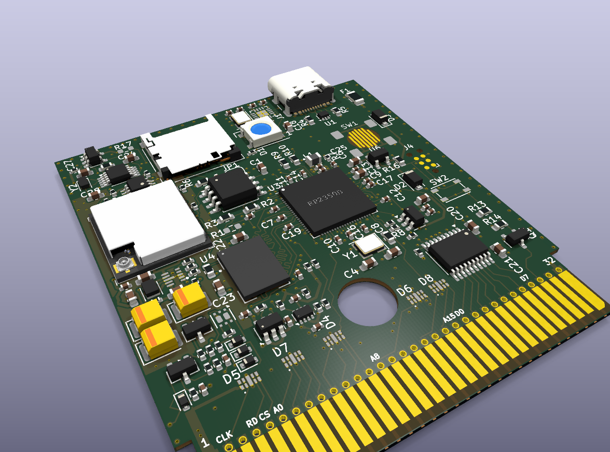
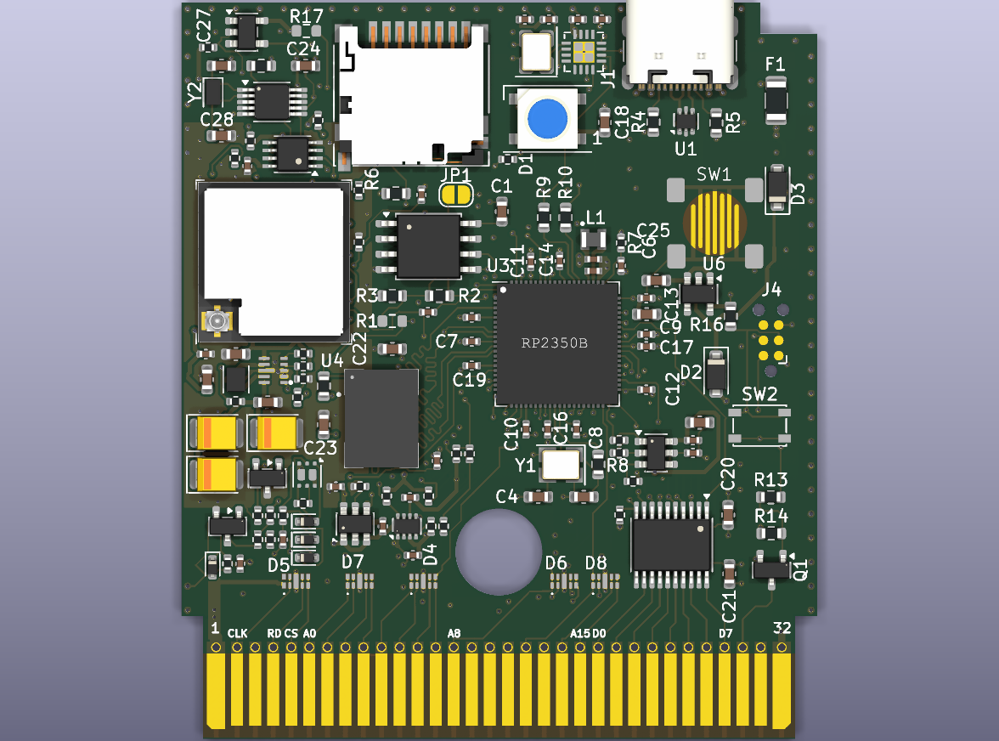
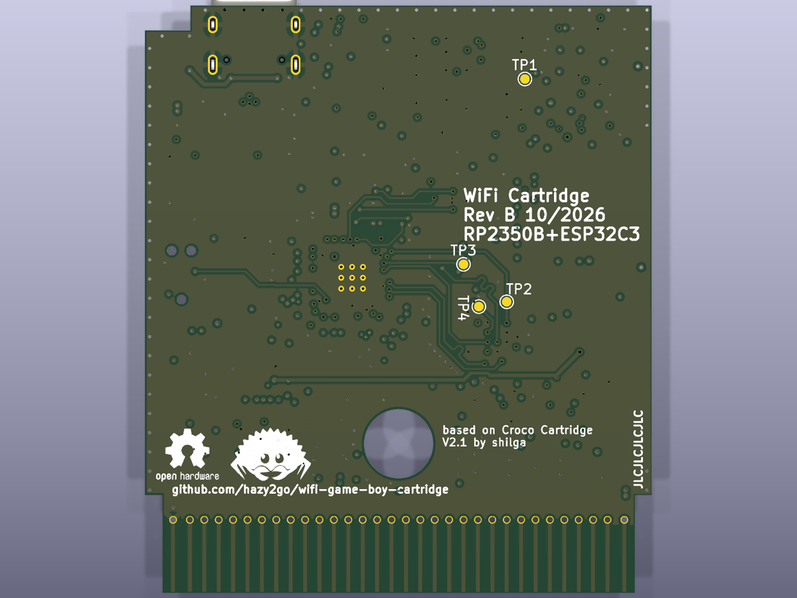

# WiFi Game Boy Cartridge (Rev B)

A WiFi cartridge for the original Game Boy and the Game Boy Color that **can't brown out the console**.
An RP2350 serves the whole cartridge bus, and an ESP32-C3 radio sits behind a power stage. That stage limits what the cart takes from the console to a steady 150 mA and never pulls the console's 5 V rail below 4.588 V.
Fully assembled by JLCPCB, nothing to hand-solder.

| | |
|---|---|
| Status (2026-10-14) | Hardware design finished, all checks green, JLC order files ready. **Not ordered yet:** two tests on an ESP32-C3 dev board come first (RF calibration energy, antenna inside the shell). Software in progress. |
| Board | 6 layers, 0.8 mm, standard cartridge shell, USB-C |
| Cartridge core | RP2350B + 8 MB HyperRAM + 16 MB flash + microSD + RTC, serving the cartridge bus over PIO (the proven Croco Cartridge design) |
| Radio | ESP32-C3-MINI-1U on the RP2350's SPI bus, stick-on FPC antenna (MHF III plug) inside the shell. Both chips flash over the one USB-C port (built-in USB hub) |
| Power | USB/console power mux → 150 mA current limit → precision input-voltage regulator (console never pulled below 4.588 V ±1 %) → ~1 mF reservoir → power-good → buck-boost to 3.3 V. The radio firmware admits every WiFi frame against the energy left in the reservoir |

## Why

Earlier WiFi carts powered the radio straight from the Game Boy's 5 V. Every transmit burst (170 to 350 mA) hit the console's weak power converter, and on tired batteries the whole system collapsed.
Here the console only ever sees a steady, limited draw. The bursts come out of a local reservoir, and if the console can't keep up, the radio waits instead of the Game Boy crashing.

| Top | Bottom |
|---|---|
|  |  |

## Proven before ordering

None of this has been built yet. Instead, everything was simulated against real part models and checked against the actual layout:
- **Power stage, at transistor level:** ngspice with TI and Vishay vendor models, covering hot-plug, bursts after idle, loop stability and every tolerance corner (`sim/power`, audits A1 to A8).
- **Full system:** a real Game Boy ROM runs in a cycle-accurate emulator and goes through the cartridge's mailbox. The models cover the RP2350, the ESP32-C3 running the *shipped* power-manager C code, and the power plant including the routed copper's resistance. Tested on fresh, tired and weak batteries (`sim/system`).
- **Layout:**
  - KiCad ERC, DRC and connectivity are clean against the Croco baseline (`verify/`).
  - Every part is checked pin by pin against the exact JLC part.
  - The placement file is derived from JLC's own footprints.

Demo ROM in that simulation: WiFi scan (real networks seen by the host), password entry, then a live BTC/USD chart:

## Repository

| Path | What |
|---|---|
| `CLAUDE.md` | Handoff: current status, rules, software to-do (start here) |
| `docs/ARCHITECTURE.md` | Block diagram, why each block, pin budget |
| `docs/LOGBOOK.md` | Every decision, check and result, in order |
| `hw/rev-b/` | KiCad project, layout tools, `fab/` order files (`fab/ORDER.md`) |
| `firmware/esp32c3/` | Radio firmware (power manager done, app in progress) |
| `sim/power/`, `sim/system/` | Power-stage and full-system simulations |
| `verify/` | Pre-order gates |
| `legacy/` | The original ESP8266 cartridge's code, PCB and shell, kept for reference only |

## Credits

- Forked from [Staacks/wifi-game-boy-cartridge](https://github.com/Staacks/wifi-game-boy-cartridge) (there.oughta.be). The original ESP8266 cartridge was the idea and the starting point.
- The cartridge core is [Croco Cartridge V2.1](https://github.com/shilga/rp-gameboy-cartridge-hw) by shilga. Firmware base: [rp2350-gameboy-cartridge-firmware](https://github.com/shilga/rp2350-gameboy-cartridge-firmware).
- The emulator in the simulation is [Peanut-GB](https://github.com/deltabeard/Peanut-GB). The DMG power-supply analysis uses [Gekkio's gb-schematics](https://github.com/Gekkio/gb-schematics).

## License

- `hw/rev-b/`: CERN-OHL-P v2, inherited from Croco Cartridge (`hw/rev-b/LICENSE-CERN-OHL-P.md`).
- `legacy/`: the original project's licenses, GPL-3 for code and PCB, CC-BY-NC-SA for the shell (see `legacy/README.md`).
- `sim/system/third_party/Peanut-GB`: MIT.
