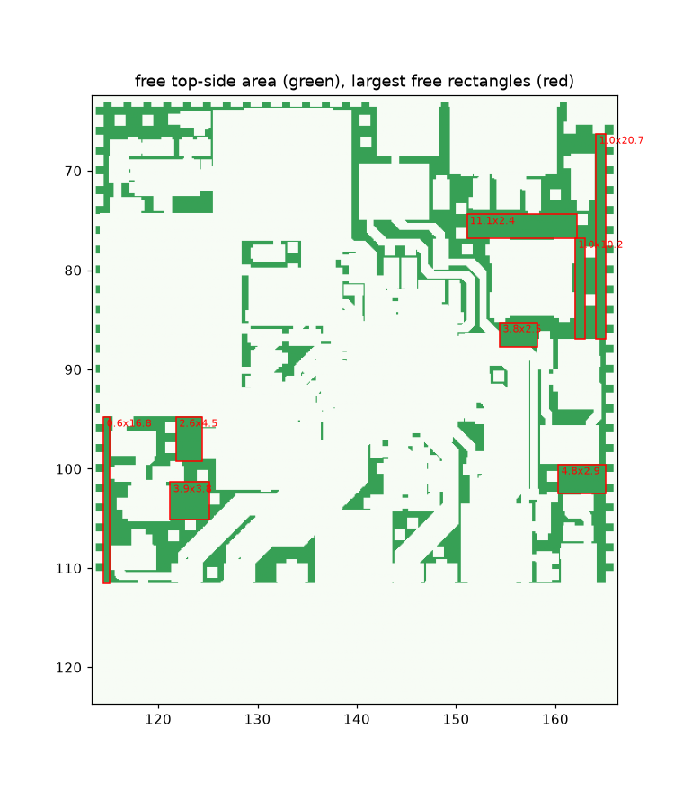
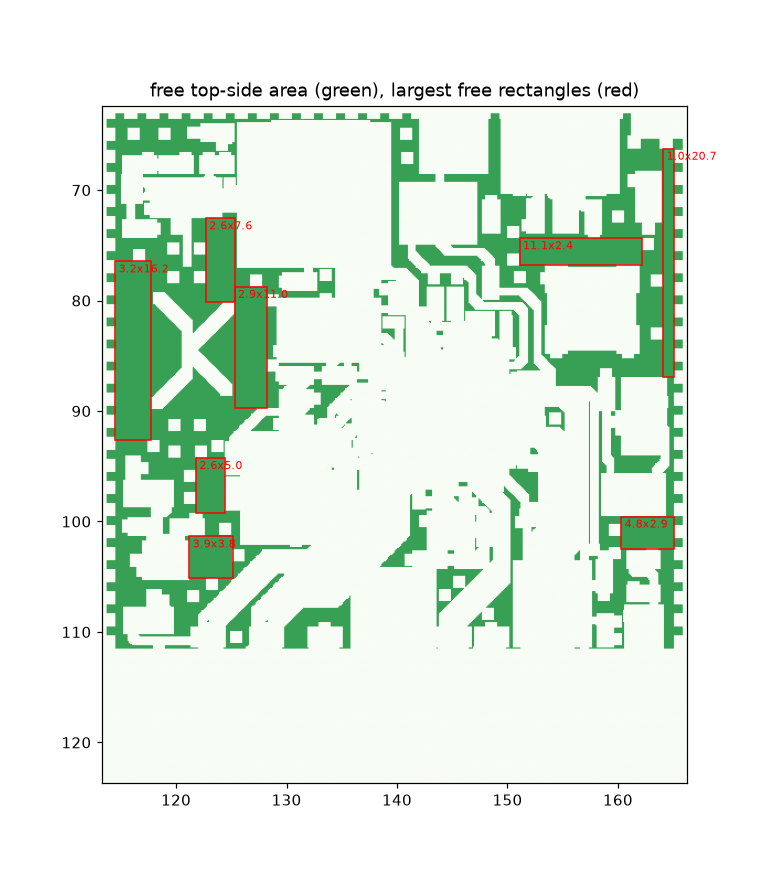
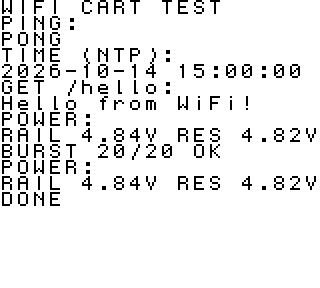
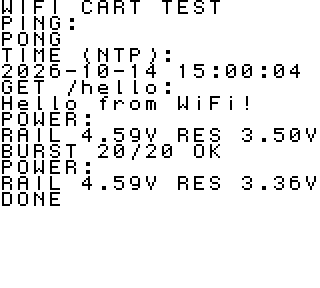
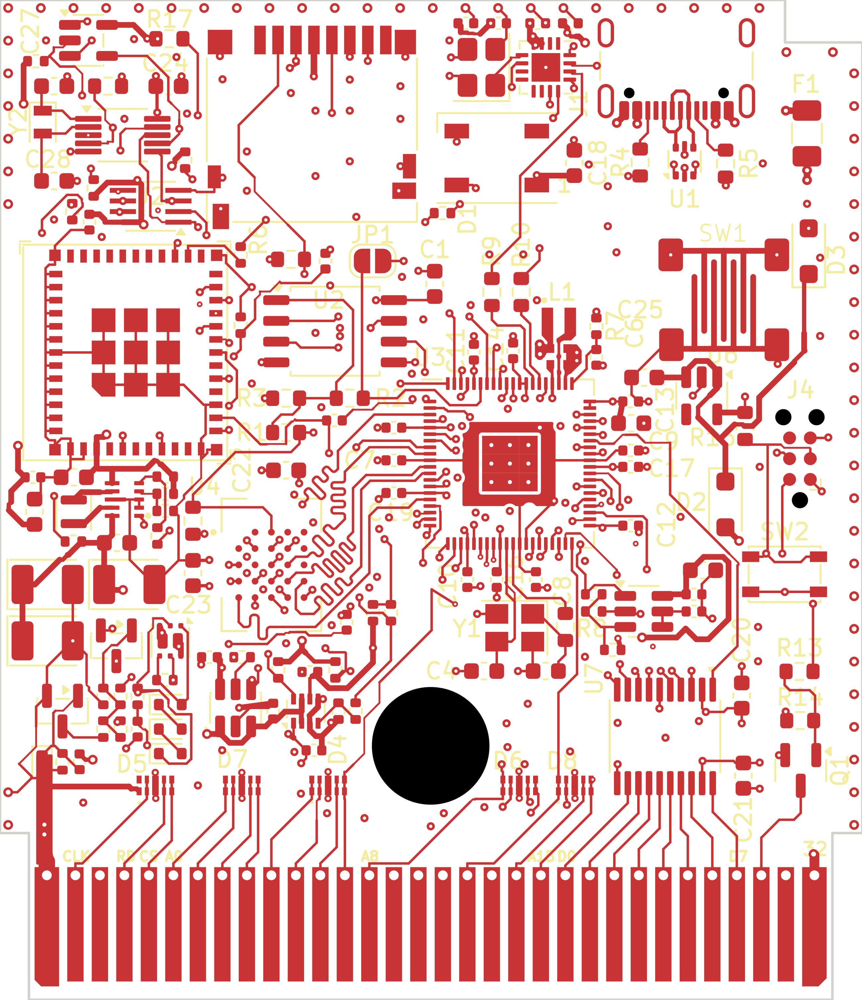
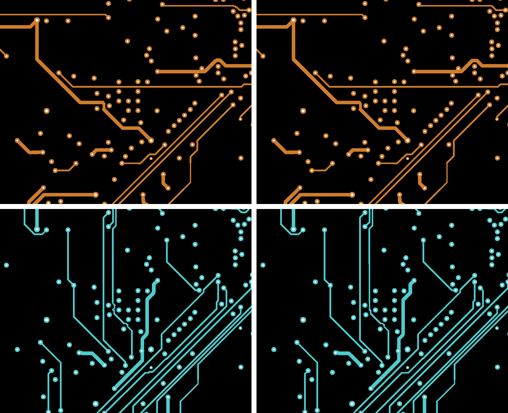
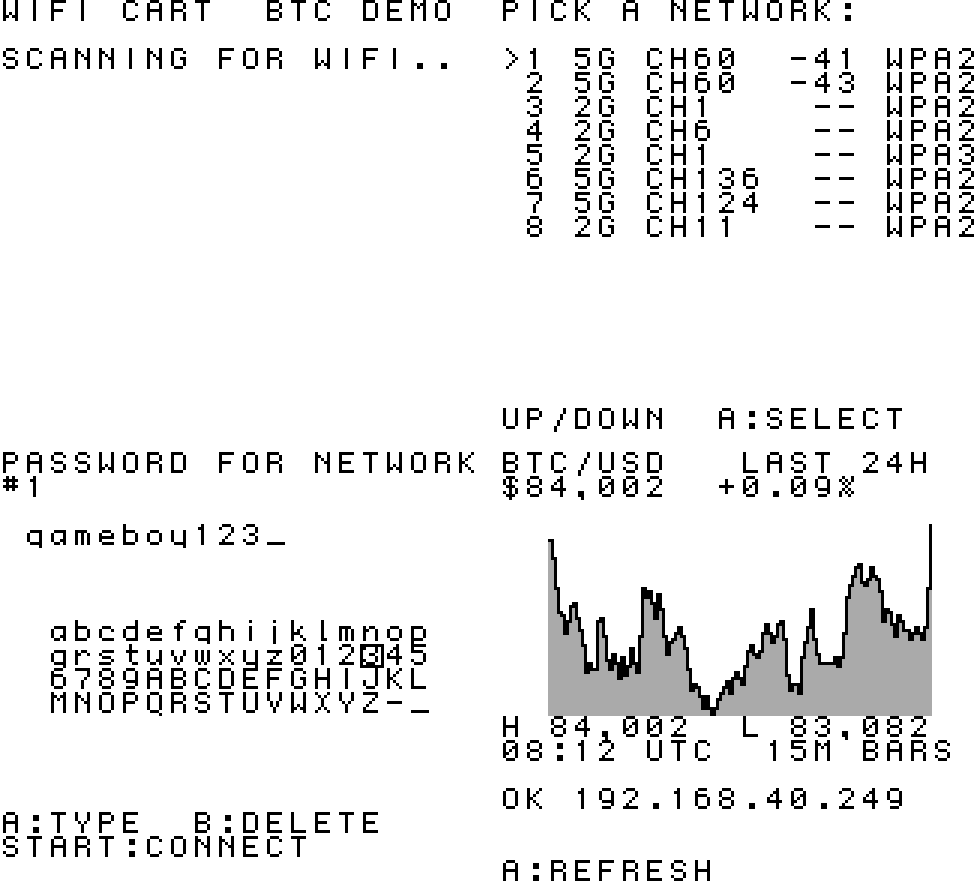
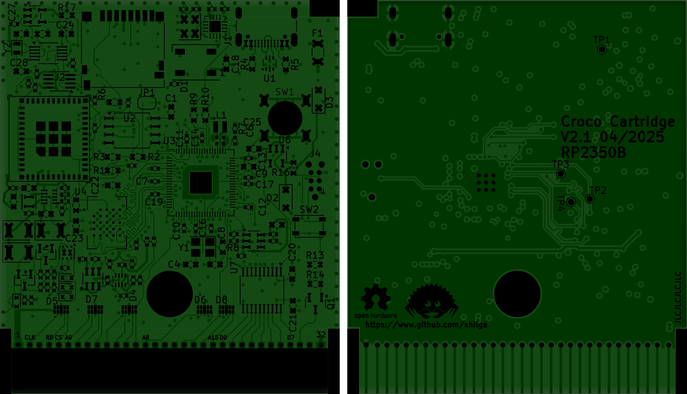
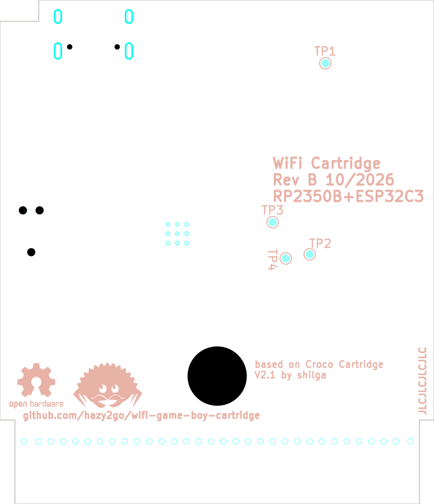

# Logbook: WiFi Game Boy cartridge, rock-solid revision

Running engineering log. Newest entries at the bottom. Every entry says what was done, what was found, why a decision was made, and what is still unverified.
Times are JST. (Corrected 04:58: the first entries were written with estimated times; all headings now match the git commit times.)

---

## 2026-10-14 04:04 Starting point

- Upstream: Staacks/wifi-game-boy-cartridge (2021). ESP8266 + 32KiB EEPROM + 74AHCT logic, two magic addresses (0x7FFE read, 0x7FFF write) mapped to the ESP.
- Upstream README: "The brown-out issues have never been resolved and this is more a proof of concept than a consumer product."
- Goal for this fork: a revision that is rock solid on every Game Boy and can be ordered fully assembled (JLCPCB PCBA). Nothing hand-soldered. Nothing gets ordered until simulation, design rule checks and a written test plan all pass.

## 2026-10-14 04:09 Fork

- Forked to hazy2go/wifi-game-boy-cartridge, `upstream` remote kept. Work happens on branch `redesign`.

## 2026-10-14 04:12 Audit of the original design

Method: parsed `pcb/wifi-gb-cart.kicad_pcb` (pad-to-net map), read the legacy schematic, BOM and every firmware file. Full findings in `docs/REDESIGN.md` section 1. The ones that matter most:

1. **Bulk capacitance on the wrong side of the regulator.** C5 680uF + C3 100uF sit on 3.3V after the NCP1117 linear regulator. A linear regulator draws from its input exactly what its output delivers, so every WiFi TX spike passes straight onto the Game Boy 5V. The caps only help once 5V has already sagged under ~4.4V (regulator dropout). This explains the author's "stable on fresh batteries only".
2. **Unlimited inrush.** Hot-plug or power-on charges ~780uF at the regulator's ~1A current limit straight from the console.
3. **Bus contention is possible in hardware.** The SN74LVC4245A transceiver direction is wired to A0 and its enable only to the address decode. /WR is not connected at all. Writing 0x7FFE makes the transceiver fight the CPU; any 0x7FFF access while ESP outputs are on shorts the 3.3V side.
4. **ESP boot-strap pins sit on the data bus** (GPIO0 = D0, GPIO2 = D2, GPIO15 = D7). A brown-out reset while the Game Boy touches 0x7FFF can strap the ESP into the wrong boot mode, so it hangs. Brown-out leads to reset leads to hang.
5. Firmware: no WiFi mode/TX power/sleep settings, ISRs mask interrupts and busy-wait with no guaranteed output-off timeout, open-drain pin init (D7 stuck low), samples taken after timed-out edge waits (ghost button presses), stack overflow in wiki.ino URL builder.
6. Board: no decoupling on U1-U5/U8/U9, top ground split into ~27 islands, status LED reversed.

## 2026-10-14 04:18 Prior art research

- Upstream issue #2 "Power instabilities" still open: 5V measured collapsing to ~3V on tired NiMH while the ESP boots. Author swapped NCP1117 for AP7361C (lower dropout), not confirmed as a fix.
- Upstream issue #6 (Jan 2026): author says he would design many things differently, BLE "might immediately solve the issue of brownouts", no further work planned.
- All 23 forks untouched. Nobody has fixed it.
- No documented current limit exists for the cartridge 5V pin on any Game Boy. DMG 5V is a crude transformer converter (2SD1664 + 4.7V zener feedback), not a regulated supply. Nintendo gave GBC rumble carts their own AAA battery. Croco Cartridge warns an overclocked RP2040 can already be too much for an original DMG.
- **Newer WiFi chips are worse on peaks, not better:** ESP8266 170mA, ESP32-C3 335mA, C6 354mA, S3 340mA, C5 up to 408mA, Pico W radio 271mA (all at 3.3V, datasheets). So the fix must be in the power path, not in the chip choice.

## 2026-10-14 04:26 Decision: Rev B (base on Croco Cartridge V2)

Options were Rev A (patch the Staacks design) or Rev B (start from Croco Cartridge V2 by shilga, add WiFi).

Chosen: **Rev B**. Why:
- Croco V2 is proven on real DMG and GBC hardware, open hardware (CERN-OHL-P v2), and already designed for JLCPCB assembly with LCSC part numbers.
- RP2350 serves the whole cartridge bus from PIO, so the fragile two-magic-byte EEPROM trick and its contention paths disappear. ROMs can be loaded over USB/WiFi instead of reprogramming an EEPROM.
- The only new risk is the radio + power stage, and that can be simulated before ordering.
- Cost: roughly $25-35 per assembled board vs ~$15 for Rev A. Worth it.

## 2026-10-14 04:27 Croco V2 board scan

Source: github.com/shilga/rp-gameboy-cartridge-hw, `KiCad/V2/GameboyCartridgeV2.1`.
- 4-layer board, outline 52.8 x 61.2 mm, 0.8mm thickness + ENIG recommended by the author.
- Contents: RP2350 (80QFN, RP2350B), W956A8MBYA5I HyperRAM, W25Q16JV flash, microSD, MCP79510 RTC + coin cell, USB-C, WS2812B LED, AP2112K-3.3 regulator, one TXB0108 level shifter, polyfuse F1, two Schottky diodes for USB/cartridge power OR-ing, TVS arrays on the bus.
- **Every component is on the top side.** The bottom side only has test points and logos. That is where the radio module and the power stage can go, without moving anything that already works.
- No bulk energy storage anywhere on V2.
- Open questions: free RP2350 GPIOs for an SPI link to the radio, shell clearance on the bottom side, antenna keep-out vs ground pours on a 4-layer board.

## 2026-10-14 04:27 Tooling

- Installed ngspice (brew) for the power simulation. KiCad 9 installing (cask) for ERC/DRC and BOM/CPL export from the command line.

## 2026-10-14 04:30 Power simulation, round 1 (plain limiter)

Built `sim/power/run_sim.py` (behavioural ngspice models, all assumptions in `sim/power/README.md`). Every run is a hot-plug into a running console, 2s, three radio load profiles, three console supply strengths.

- **Model sanity check passed:** the original design on a weak supply drags the console rail to 2.8V on hot-plug. Upstream issue #2 measured ~3V. Same failure, same size.
- Swapping the original's ESP8266 for an ESP32-C3 makes it much worse (tired console: 3ms below 4.5V becomes 353-747ms). Confirms "a newer chip alone is not a fix".
- A plain 150mA limiter + reservoir fixes fresh and tired consoles (rail never below 4.63V) but **fails on a weak console**: the rail sits at 4.39V the whole time, because 100mA console + 60mA Croco + 150mA radio is too much for a weak supply.

## 2026-10-14 04:32 Round 2: input-voltage regulation (DPM)

Idea taken from solar/USB battery chargers: instead of a fixed current, the cartridge only takes what the console can give while its rail stays above a threshold.
- With fold-back at 4.6V: console rail never below 4.62V in all 9 cases. But on a weak console the radio starved: reservoir fell to 2.05V, radio nearly lost power.
- Added a firmware power-save state (radio drops to modem-sleep when the reservoir is low). Still starved at 4.6V; at 4.5V fold-back there is enough headroom.

## 2026-10-14 04:34 Round 3: throttle thresholds (the non-obvious one)

- With the firmware throttle at 3.0V the reservoir lived at ~3V. A linear current limiter delivers I x V(reservoir) into the cap and burns the rest, so at 3V it only delivers ~60% of what it takes from the console. Throughput was capped at 79% on busy traffic.
- Raised throttle to 4.0V and power-save to 3.5V: the reservoir lives near 4-4.5V where the limiter is efficient. Busy-traffic throughput went to **99%** at the same 150mA.

**Result with the full design (150mA limit + 4.5V fold-back + 4.0V throttle + 3.5V power-save):**
- Console rail never below 4.5V in any of 9 scenarios (fresh 4.78V, tired 4.63V, weak 4.54V min). The original dropped to 4.23 / 3.67 / 2.80V.
- Radio never browns out (reservoir never below 3.5V after power-good).
- Throughput fresh/tired: 99% busy traffic, 72-80% worst-case 802.11b, 62% artificial stress. Weak console: radio stays connected in modem-sleep but sends almost nothing. The game never crashes, which is the trade we want.

Still unverified (needs real hardware): actual console supply impedance, Croco's real current, ESP32-C3 modem-sleep average, real fold-back circuit behaviour. A part search for a buildable fold-back circuit is running.

## 2026-10-14 04:37 Finding a real chip for the fold-back

Part search (datasheets downloaded, stock from JLC's API):
- **BQ24075** (TI Li-ion charger with power path, C15464, 16.7k in stock, ~$1.07). Has a VIN-DPM loop: below 4.5V typ (4.35 min, 4.63 max) on its input it cuts current. Checked in the datasheet text: VIN-DPM is only active in USB100/USB500 modes (EN2 low). Resistor-ILIM mode has no DPM. Used with charging disabled (CE high) and BAT switch off (SYSOFF high), its OUT pin is simply a current-limited, input-regulated supply for our reservoir.
- Caveat: datasheet recommends 4.7-47uF on OUT; we put ~1.4mF there. Soft-start charges OUT at 100mA until 0.9V, then the selected limit. Expected fine, must be bench-tested.
- TPS2553 ILIM cannot be used for fold-back (sinking current from ILIM *raises* the limit; ILIM resistor range 15-232k for loop stability).
- Discrete op-amp/TLV431 + PMOS fold-back = fallback (loop compensation unverified).
- MCP73871 (VPCC adjustable) rejected: VPCC only cuts battery charging, load on OUT is unprotected.
- Rejected for stock/specs: BQ25173 (no VINDPM, 0 stock), BQ25185 (100uF max on SYS), LTC4041/LTC3226 (cost/stock), MAX38889, BQ25190, BQ25504/BQ25570.

## 2026-10-14 04:39 Power simulation, round 4: real BQ24075 behaviour + tolerance corners

Ran the BQ24075 alone in both modes and then the combination:
- USB100 alone (95mA): console safe, but only 34% of busy-traffic airtime. Too little.
- USB500 alone (500mA + DPM): 100% airtime, but on a fresh console the rail rides down to ~4.59V on every burst (0.3-0.4V ripple on the console supply = speaker noise risk, the original's audio static complaint).
- **Chosen: TPS2553 at 150mA in front of BQ24075 in USB500.** The TPS2553 gives a smooth constant ceiling, the BQ24075 a guaranteed input-voltage loop. Typical part: identical to the idealised design (fresh/tired 99% airtime, rail >= 4.63V; weak rail 4.52V).
- Tolerance corners exposed two weak-console problems:
  - DPM at 4.35V (min): rail sat at 4.39V for most of the run.
  - DPM at 4.63V (max): radio starved, reservoir fell to 2.06V, radio power-good cycling.
- Fixes: (1) radio firmware also watches the cart rail on its ADC and backs off below 4.55V, (2) precision 4.45V comparator gating the charge path as a hard floor (instead of the 4.38V APX803).
- Result: worst corner is now a single 57ms dip to 4.46V right at plug-in on a weak console with a min-tolerance BQ24075, then >= 4.5V. Max-tolerance corner on a weak console: radio parks/cycles, console unaffected. Firmware rule added: if the reservoir falls below 3.0V the radio goes to deep sleep and retries later, instead of cycling.

## 2026-10-14 04:41 How the radio connects to Croco

- Mapped every RP2350B pin from the Croco V2 PCB netlist: **all 48 GPIOs are used** (GB bus 17-45, HyperRAM 6-16, SPI0 + SD/RTC 0-3/5, button 4, debug UART TX 46, WS2812 LED 47).
- Croco V2 firmware is Rust/Embassy (shilga/rp2350-gameboy-cartridge-firmware, GPL-3). GPIO46 is only defmt-serial logging.
- Croco power path (from netlist): cart VCC -> D2 Schottky -> +5V -> AP2112 3.3V; USB VBUS -> F1 -> D3 -> +5V. **The new power stage must tap raw VCC before D2**, otherwise the DPM loop sees ~0.3V less and folds back on healthy consoles.
- Decision: ESP32-C3 as an SPI slave on the existing SPI0 bus with chip select on GPIO46 (debug logging moves to defmt-RTT over the existing SWD Tag-Connect). MISO through a 74LVC1G125 tri-state buffer gated by that chip select. RP2350 polls, no IRQ line. Keeps LED, RTC and SD untouched.
- Power mux (prefers USB) in front of the stage so the radio works and can be flashed on USB alone.
- Radio flashing without soldering: ESP32-C3 native USB; preferred a USB hub chip behind the USB-C (both chips enumerate), fallback analog USB switch + slide switch.
- Details: `docs/ARCHITECTURE.md`.

## 2026-10-14 04:43 KiCad baseline

- KiCad 10.0.6 installed. Ran ERC/DRC on the **unmodified** Croco V2.1 files to have a baseline before touching anything.
- DRC (zones refilled): 199 solder-mask bridges, 107 clearance, 15 shorting items, 10 via diameter, 4 hole clearance, 3 unconnected, 2 items-not-allowed. ERC: 262 (mostly library/symbol link issues from opening a KiCad 8/9 project in 10).
- Spot checks: the "shorts" are copper graphics inside footprints (SW1 soft button, J5 edge connector polygon); clearance hits use KiCad 10's default 0.2mm board minimum, Croco was designed to tighter JLC 4-layer rules. These boards were ordered and work, so most of this is rule configuration, not real defects.
- Next: set an explicit JLC 4-layer rule set, re-run, and triage what is left into real vs. artefact **before** adding anything, so every new violation is ours.

## 2026-10-14 04:44 Open mechanical question: does anything fit on the bottom?

- A cartridge shell has limited interior depth. The coin-cell holder, USB-C and microSD on the top side set where the PCB sits. If the bottom only has ~1mm, a 2.4mm-thick ESP32-C3-MINI-1 does not fit there.
- Antenna: a PCB antenna needs a copper keep-out on all 4 layers and must sit in the part of the cart that sticks out of the console. The top edge of Croco V2 is crowded (USB-C, microSD, LED, RTC crystal). Leaning towards ESP32-C3-MINI-1U (u.FL) + a stick-on FPC antenna in the shell's label area: plugs in, no soldering.
- Research on shell clearances and stock for the remaining parts (power mux, USB hub, buffer, low-profile reservoir caps, MINI-1U, antenna) is running.

## 2026-10-14 04:54 Mechanical result: the bottom side is unusable (plan change)

Measured a community 3D model of an original-style DMG shell (Printables #804399, ±0.2mm, cross-checked against Wikipedia's 65.5 x 57 x 7.5mm):
- Back wall ~1.15mm, front (label) wall ~2.0mm, interior cavity 4.65mm (5.3mm near the connector).
- Full-width ribs on the label half come down to 2.5mm, at the shoulder and at the top edge, forming a 1.35mm slot the PCB sits in.
- Croco's 3.38mm coin-cell holder only fits on the rib side, so Croco's top side faces the label half and its **bottom side lies on the back wall: ~0mm usable, 0.55mm at best**. Even cutting a window through the back wall gives ~1.7mm, less than the module's 2.55mm max.
- Top side budget 3.3-3.85mm: a 2.4mm module fits in height, but a 2mm occupancy grid of Croco's top side shows **no free 13 x 17mm area**.
- Precedent: Staacks used a 1.6mm PCB and a modified 3D-printed shell and wrote he doubted it fits any normal cartridge.

**Conclusion: the earlier "put the radio on the empty bottom side" plan is dead.** The radio must go on the top side, which means changing Croco's top layout.

Other findings from the same search:
- 6TPE470MI reservoir caps are **3.8mm tall**, too tall for either side. Low-profile replacements: 6TPE330MAP (330uF, 1.8mm, 25 mOhm, C79112) or 6TPE220MI (220uF, 1.8mm, 18 mOhm, C129173). Reservoir has to be re-simulated with the smaller total.
- Stock (JLC API): ESP32-C3-MINI-1U-N4 C2911374 (1740), MINI-1-N4 C2838502 (8243), TPS2116DRLR power mux C3235557 (72k), CH334P USB hub C5373042 (28k, crystal optional per datasheet), TS3USB221 C128396, SN74LVC1G125 C23654, TLV431A C56765, u.FL U.FL-R-SMT-1 C88374. FPC antennas are not JLC-assembled (plug-in after delivery).
- Bare ESP32-C3FH4 QFN (0.9mm): JLC 13k stock but LCSC 0; needs our own RF matching network. Higher risk than a certified module.

Candidate ways to make room on the top side (decision pending with Hazy):
1. Replace the CR1220 coin-cell holder (largest top part, ~13 x 15mm footprint) with a small SMD rechargeable cell (e.g. ML621) and resync the clock over WiFi (NTP). Put the ESP32-C3-MINI-1U where the holder was, u.FL cable to a stick-on antenna in the shell's grip end.
2. Keep the coin cell, relayout the whole top side tighter (high effort, high risk on a proven board).
3. Bare ESP32-C3 chip with our own RF design (smallest, riskiest).

## 2026-10-14 04:57 Decision: option 2, keep the coin cell, relayout the top side (Hazy)

- Hazy chose to keep the CR1220 coin cell (clock retention for years) and relayout Croco's top side to fit the radio + power stage.
- Area budget from the board file (KiCad pcbnew API, courtyard areas, top side): board 52.95 x 61.34mm. Edge connector region ~540mm2. Existing top parts excluding the connector ~1370mm2 of ~2650mm2 usable (52%). New parts estimate ~520mm2 courtyard (MINI-1U ~190, 3 reservoir caps ~110, BQ24075/TPS2553/TPS63802/mux/hub/buffer + passives ~220). After: ~71% density. Tight but realistic for 4 layers with 0402 passives.
- Layout constraints to respect: top-side height 3.3-3.85mm, shell ribs at ~11mm and ~62mm from the connector end (keep tall parts out of those bands, Croco already does), antenna cable to the grip end.

## 2026-10-14 04:59 Power simulation, round 5: low-profile reservoir

The 3.8mm-tall 6TPE470MI does not fit, so re-ran the chosen design with 1.8mm-tall 6TPE330MAP (330uF, 25 mOhm) in parallel:

| caps | radio up after plug-in | busy traffic | worst 802.11b (fresh/tired) | stress | console rail |
|---|---|---|---|---|---|
| 2x 330uF | 18ms | 99% | 54% / 50% | 63% | unchanged |
| **3x 330uF** | 27ms | 99% | 65% / 59% | 62% | unchanged |
| 4x 330uF | 37ms | 99% | 76% / 68% | 62% | unchanged |

- Console safety does not depend on reservoir size at all (the limiter and the DPM loop decide that). Reservoir size only buys airtime for the long 12ms 802.11b frames.
- **Chosen: 3x 6TPE330MAP (~1mF).** Firmware will disable 802.11b rates (`esp_wifi_config_11b_rate`), which removes the 12ms frames that need the big reservoir in the first place.

## 2026-10-14 05:00 Schematic tooling

- Several new parts have no KiCad library symbol (TPS2553, TPS63802, ESP32-C3-MINI-1U, the comparator). Present in KiCad 10: TPS2116DRL, BQ24075RGT, CH334F/R, SN74LVC1G125DBV.
- Decision: the radio sheet is **generated** from one machine-readable netlist (`docs/design/netlist_radio.json`) by `hw/rev-b/tools/gen_radio_sheet.py`. Every pin gets a label, power symbol or no-connect marker; a pin missing from the JSON is a hard error. The same JSON will drive footprint/net assignment on the PCB, and KiCad's DRC schematic-parity check will prove the two match. Why: no hand-drawn wire can silently miss a pin, and the design is reviewable as a table.
- `tools/add_radio_sheet.py` adds the "Radio" hierarchical sheet to Croco's root schematic once (fixed sheet UUID so references stay stable across regenerations).
- Smoke test on a copy with 3 parts: sheet loads in KiCad 10, ERC runs and reports exactly the expected undriven-input errors for the test parts.
- A datasheet-level design pass (pin tables, component values with equations and citations, LCSC numbers, footprints) is running and will produce the JSON.

## 2026-10-14 05:02 Top-side occupancy map

- Rendered every top-side courtyard from the board file, with the approximate shell rib bands (red) and a 13.2 x 12.5mm MINI-1U outline for scale.
- Candidate areas: right column around SW1/J4/SW2 (x 150-166, y 76-100), lower-left around D2/D3/U6/C25/C26 (x 113-125, y 95-112), and the top-center if the debug header J3 goes (GPIO46 becomes the ESP chip select, so the UART header has no job left).
- Constraint: Croco's HyperRAM (U4) and RP2350 (U3) routing is the timing-critical core. The relayout should move peripheral parts and leave the U3/U4/U2/Y1 core routing untouched.

## 2026-10-14 05:04 Layout tooling

- Installed OpenJDK 21 and Freerouting 2.5.0 (jar, `~/Projects/tools`). Plan: lock Croco's existing core routing, export Specctra DSN from pcbnew, autoroute only the new and moved nets headless, import the session, then DRC + schematic parity. Every autorouted net gets reviewed against the board's rules before it is accepted.
- Logbook rule from now on: every heading time comes from the system clock at the moment of writing (two entries had been written with guessed times and were corrected).

## 2026-10-14 05:22 Audit loop (Hazy: "audit loop every test, simulate, emulate")

New rule for the rest of the project: **every result gets a scripted check with a pass/fail limit, and an independent second way of getting the same number.** A result that has not passed its audit is not reported as a result. Harness lives in `verify/` and `sim/power/audit.py`.

### What the audit is made of

| id | check | how it is independent |
|---|---|---|
| A1 | ngspice vs `sim/power/pyref.py` on the chosen design, 3 consoles x 3 profiles | pyref is a fresh fixed-step integrator written from the circuit equations; shares only parameter values with the SPICE netlists |
| A2 | ngspice at 20us vs 5us max step | catches timestep artefacts |
| A3 | console-rail floor vs closed-form steady state | pencil-and-paper algebra |
| A4 | energy sanity (source energy > radio energy) | conservation |
| A5 | realistic firmware across tolerance corners | see below |
| K1 | KiCad ERC/DRC/parity vs recorded baseline of unmodified Croco V2.1 (`verify/kicad_check.py`) | fingerprints every violation; any new one fails |

The KiCad gate was itself tested: deleting one track segment in a scratch copy made it FAIL with 2 new clearance violations (mutation test). A gate that cannot fail is not a gate.

### A1-A4 result: the math was right

- A1: ngspice and pyref agree to <= 0.2 mV on the console minimum, <= 0.3 points on TX airtime, <= 0.02 ms on radio start. All 27 checks PASS.
- A2: 20us vs 5us: <= 0.3 mV, <= 0.05 points. PASS.
- A3: console floor 4.783 / 4.628 / 4.516 V (fresh/tired/weak), identical to the closed-form solution. PASS.
- A4: PASS.

### Problems the audit found in my own earlier work

1. **Tolerance corners were run on the wrong reservoir.** `final_lo`/`final_hi` used the old 1.41 mF bank, not the 0.99 mF (3x 330uF) bank that was chosen at 04:59.
2. **A hidden failure in the committed results.** Weak console + DPM at its 4.63 V maximum: reservoir minimum 2.06 V, i.e. the radio was sitting on its power-good cut-off. It was in `results.txt` but I did not call it out.
3. **`results.txt` was not reproducible** from the committed script (a duplicated `final` row from an earlier variant list). Will be regenerated by the harness.
4. **The SPICE firmware model was too kind.** It throttles TX continuously, i.e. it can stop a WiFi frame half way. A real radio cannot. It also throttled the boot RF calibration, which is not throttleable.

### Datasheet audit (sub-agent, primary sources)

- TPS2553 "150 mA" (RILIM 180k) is really **129 / 150 / 174 mA** (datasheet Eq. 1 min/nom/max). Corner sweep now uses 129-174 mA.
- TPS2553 does **not** block reverse current instantly (3-7 ms deglitch). Reverse blocking has to come from the stage after it.
- **BQ24075 VIN-DPM only works in USB100/USB500 mode** (EN2 low); in ILIM-resistor mode there is no input-voltage regulation. USB500 behind the 150 mA TPS2553 is fine (that is TI's own Fig 9-3 case), but:
  - VIN-DPM is 4.35 / 4.50 / 4.63 V. At the 4.35 V corner a weak console sits at ~4.45 V while the reservoir charges.
  - It is a Li-ion charger used without a battery. Datasheet says it runs with an absent battery but runs a 250 ms battery-detection cycle forever; the sleep comparator (VIN > VBAT + 55-130 mV, BAT near 4.2 V with no cell) is only ~0.15 V above the DPM minimum. Thin.
  - Input FET drop implies 0.3-0.48 ohm (no RDS(on) given). Corner sweep now uses 0.2-0.6 ohm total switch path.
- ESP32-C3-MINI-1U: TX peak **350 mA** (11b 20.5 dBm), 295 mA (11g), RX 82-84 mA, modem-sleep 13-28 mA, light-sleep 130 uA. Datasheet wants a supply able to deliver >= 0.5 A (the reservoir + buck-boost provides the peak, the input does not).
- TPS63802: starts above 1.8 V, runs down to 1.3 V; ~91-94 % efficient at 3.6-4.2 V in, 300 mA out (read from curves). 0.88 was conservative.
- 6TPE330MAP: 330 uF, 25 mOhm, 1.8 mm, 6.3 V (79 % of rating on a 5 V rail), leakage up to 208 uA each.
- No published current budget for the cartridge slot on any Game Boy. Pan Docs: whole DMG is ~0.7 W. **Our 150 mA at 5 V is about the same power as the entire console.** This is the strongest argument for keeping the limit low.

### A5: firmware as a state machine (pyref.simulate_fw)

Radio states OFF / BOOT (RF calibration, uninterruptible) / RUN / SLEEP / PARK, all decisions from a 1 ms ADC sample, frames admitted only if the reservoir is predicted to stay above 3.0 V at the end of the frame, never aborted. Uncontrolled reset = reservoir falls through power-good (2.0 V) while the radio is on.

Findings:
- **Console safety holds on fresh and tired consoles in every corner** (129-174 mA, DPM 4.35-4.63 V, logic 40-100 mA, efficiency 0.80-0.92, switch path 0.2-0.6 ohm, three traffic profiles).
- **Weak console at the DPM 4.35 V corner: console sits at 4.46 V** for as long as the reservoir is charging. That is below the 4.5 V line. Root cause is the BQ24075 tolerance, not the topology.
- **The RF calibration at WiFi start decides whether the radio survives.** Usable reservoir energy 4.2 -> 2.0 V is 6.75 mJ. A TX-heavy calibration phase at 50 % duty drains it in ~13 ms at the worst corner and ~37 ms at nominal. Calibration of 5 ms is fine, 20 ms at 50 % causes a controlled park on fresh consoles and reset loops on weak ones. The real calibration current profile of the ESP32-C3 is the number that matters most now; research running.
- The 12 ms 802.11b frames are not survivable with this reservoir under realistic gating (radio reset loops at the low-current corner). **Firmware must disable 11b rates and A-MPDU TX** (frames <= ~2.5 ms). This becomes a hard firmware requirement, not an optimisation.

## 2026-10-14 05:29 Firmware co-simulation (the "emulate" part) and research results

### The real firmware is now in the loop
- `firmware/esp32c3/components/power_mgr/power_mgr.{c,h}`: the radio power manager as plain C (no ESP-IDF dependency). This is the code that will ship on the ESP32-C3.
- `sim/power/cosim.py` compiles it for the host (`cc -Wall -Wextra -Werror -std=c11`), calls it through ctypes on every 1 ms ADC tick, and integrates the analog power path between ticks.
- **A6**: the shipped C code and the independent Python model of the same spec (`pyref.simulate_fw`) must agree on console minimum (5 mV), TX airtime (3 points), reservoir minimum (30 mV), time below 4.5 V (5 ms) and on whether the radio resets. **36/36 PASS** over 3 consoles x 4 traffic types x 3 tolerance corners.

### Bugs the cross-check found (both models had them, in different places)
1. **RUN/SLEEP chattered every millisecond on a weak console.** The cart-rail watch had no hysteresis, so the firmware flipped state on every ADC tick and the results depended on sample phase (C and Python disagreed by up to 93 points of TX airtime). Fix in the firmware: sleep below 4.55 V, resume above 4.60 V.
2. **Python model admitted frames late.** If a burst started while in SLEEP and the state changed to RUN 1 ms later, it started a frame mid-burst. The C code only decides at the start. Python fixed to match the spec.
3. **Python counted calibration pulses as delivered traffic.** Metric fixed.
4. The reservoir-minimum metric was dominated by the power-up moment, not by traffic. Both models now measure it over the traffic window.

### Research results (primary sources, sub-agent)
- ESP-IDF: **full RF calibration takes 100 ms longer than partial**; partial (default) reuses full-calibration data stored in NVS. No published current profile or duration for partial calibration on the C3.
- ESP32-C3 auto light-sleep with DTIM1 averages **1.4 mA** (modem-sleep 21.5 mA). Light-sleep is the better SLEEP mode for weak consoles.
- **802.11b cannot be fully switched off.** `esp_wifi_config_11b_rate` disables 11b data rates, but an open ESP-IDF issue (#19164) shows a station still sending at 1/2/5.5 Mbps, and management frames go out at 1 Mbps. So the 1 Mbps fallback has to be handled by **limiting frame size** (MTU/MSS), not just by configuration.
- Open issue #17881: a brown-out during TX on a C3 can leave the RF stuck on after reset. Our power-good gate removes the radio's supply completely below 2.0 V, which is the right response to that bug. It is another reason the design must never let the radio brown out.
- Input-voltage-regulation parts: no off-the-shelf part guarantees +-1.5 %. Best found: MP2617A (switching charger, +-2 % reference), BQ24251 (I2C, +-2 %, 0 stock), BQ25601 (I2C, +-3 %).

### A5/A7 results with the C firmware and the datasheet corners
- Fresh and tired consoles: console never below 4.5 V and **zero uncontrolled radio resets** in every corner (ilim 129-174 mA, DPM 4.35-4.63 V, logic 40-100 mA, efficiency 0.80-0.92, switch path 0.2-0.6 ohm, 4 traffic types).
- Weak console: zero radio resets; console safe in every corner **except DPM at the 4.35 V minimum** (4.45 V for up to 1.1 s while the reservoir charges). That is the one remaining FAIL and it belongs to the BQ24075's tolerance.
- **Calibration budget (A7): the radio survives up to 10 ms of calibration at 50 % TX duty at the worst corner.** Requirements that follow:
  - do the first full calibration on USB power (when flashing) and store it in NVS; the cart slot must never see a full calibration;
  - measure the partial-calibration current profile on a dev board before ordering. Pass if it is below the 10 ms @ 50 % energy (about 7 mJ above the input supply).
- With forced 1 Mbps frames of 4.5 ms (536-byte MSS) the admission rule refuses everything at the worst corner (it assumes no input during the frame). **MSS has to come down to about 300 bytes** for the 1 Mbps fallback case, or the admission rule must count the guaranteed input current. To do in the firmware.

## 2026-10-14 06:03 Replacing the BQ24075: precision input-voltage regulator, transistor level

### Why
The BQ24075 was the only A5 failure (weak console at its 4.35 V VIN-DPM minimum). It is also a Li-ion charger running without a battery (endless 250 ms battery-detect cycle, sleep comparator ~0.15 V above the DPM minimum). Research found no stocked part with a resistor-set threshold better than +-2 %. So: a discrete loop.

### Circuit (sim/power/inreg.py)
`VMUX -> TPS2553 (150 mA) -> back-to-back PMOS pair (Vishay SiA975DJ dual, C141597) -> VRES`. A TLV431B (0.5 %, C398375) watches VMUX through 27.0k/10.0k (set-point 1.24 x 3.7 = 4.588 V) and pulls the shared gate down when the console rail is above the set-point. Back-to-back so neither the reservoir nor USB can ever feed the cart rail. The divider senses the mux output, so on USB power the regulator is simply fully on.

### Vendor models (sim/models/)
- A helper downloaded TI's TLV431 (SLIM005), TPS2553 (SLVM425), TPS63802 (SLVMCX1) and Vishay SiA975DJ / Si2371EDS models and checked each against its datasheet: TLV431 1.2409 V and 0.251 ohm dynamic impedance (datasheet 1.240 V, 0.25 ohm); SiA975DJ 54.8 mOhm at -2.5 V (datasheet 49 typ / 60 max); TPS2553 limit 1.288 A at 20k (equation 1.28 A).
- Two TI models were silently broken in ngspice: PSpice's boolean XOR `^` is the power operator in ngspice, which disabled the TPS2553 a millisecond after start; the TPS63802 one-shot had a zero-delay loop. Both patched, documented.
- Model caveat: the TLV431 model's regulation knee is too soft below ~0.5 mA (sinks current slightly below the threshold). Pessimistic for us; designs are kept in the >0.5 mA region.
- **Licence:** TI/Vishay allow simulation use, not public redistribution. The repo is public, so the vendor files are git-ignored and `sim/models/fetch_models.py` downloads them, checks SHA-256 and applies the patches. Audited: its output is line-for-line identical to the hand-patched files.

### Results so far
- DC: regulates the console at **4.589-4.598 V** from weak (2.5 ohm) to tired-plus (1.4 ohm) consoles (load regulation 9 mV). Fresh and tired consoles are above the set-point at the full 150 mA, so the regulator is simply fully on there.
- Loop gain (Middlebrook injection between VMUX and the divider, where the impedance ratio is ~37k : 1 ohm): with Cc = 10 nF from cathode to REF, crossover 14-390 Hz, **phase margin 69-85 deg**, gain margin > 57 dB across console impedance 1.4-2.55 ohm and console capacitance 47-220 uF.
- Bug in my own harness, caught by a nonsense result: the DC operating point converged to VCC = 1.09 V for one variant, and the AC analysis was then computed around that garbage point (it showed PM "999"). Fix: `.nodeset` initial guess, and every operating point is checked for plausibility.

### Problem found: integrator wind-up
New transient tests (cart-side soft start modelled: TPS2116 1 ms, TPS2553 1.5 ms rise):
1. **Hot-plug on a weak console:** VCC dips to 4.38 V (R = 2.0 ohm) for ~4 ms.
2. **Burst after idle (worse, it happens in normal use):** when the reservoir is full no current flows, the console looks healthy, so the TLV431 integrator winds all the way to "fully on" (cathode at 0 V, Cc charged the wrong way). The next radio burst drains the reservoir, the full 150 mA flows instantly, and the loop needs 3-5 ms to unwind. VCC 4.38 V at 2.0 ohm, 4.29 V at 2.3 ohm.

What did not fix it (all simulated, numbers in `sim/power/inreg_search.py` history):
- TPS2553 enable delay (15 ms): no change, the wind-up happens anyway.
- Bias resistor from VMUX to the cathode: no change.
- Faster/larger proportional term (Rc up to 2.2 M): hot-plug improves but phase margin collapses to 14-38 deg, and crossover moves to 14-74 kHz where the TLV431 macro-model is least trustworthy. Rejected.
- Gate capacitor as the dominant pole instead of Cc: unstable (negative phase margin).

**What works: anti-wind-up clamp.** Move the integrator capacitor to the gate node and clamp the gate to at most ~2 diode drops below the source. The integrator can then only wind up to "just fully on" (~0.4 V of extra swing instead of ~3.4 V), and the TLV431's current in saturation is bounded by Rk. First results: burst-after-idle +17 to +74 mV margin (was -213 mV), hot-plug +8 mV with Rk 2.2k / Cc 2.2 nF; phase margin 42 deg there, just under my 45 deg rule. Fine-tuning Rk/Cc/Rc now.

## 2026-10-14 06:20 A8: formal regulator audit of the anti-wind-up candidate (Rk 2.2k, Cc 2.2n on gate, Rc 10k, 2-diode clamp)

`sim/power/audit_inreg.py`, ~140 corners (console 1.4-3.0 ohm and 47-220 uF, Cc +-10 %, Rk/Rc +-1 %). **58 FAIL. Not accepted.** What it found:
1. **The clamp starves the charger.** Two diodes clamp the gate to about -1.2 V, which on the SiA975DJ only passes ~70 mA when the reservoir is low (FET in saturation, 0.6 V overdrive). At 1.4 and 1.8 ohm the console sits at 4.67 V instead of 4.59 V, i.e. the "regulator" is stuck on the clamp, loop gain -55 dB. Safe for the console, but it would halve the radio's power on fresh consoles. The clamp needs to sit near -1.5 V (enough overdrive for 150 mA, little extra wind-up).
2. **Hot-plug on the weakest consoles (2.5 ohm with 47 uF, 3.0 ohm):** dips 7-82 mV under the limit. At 3.0 ohm the console alone is below the set-point, so the regulator should never turn on. Suspect the TLV431 model's soft knee (it sinks current 1.5 % below the threshold, the real part does not). Needs a cross-check with an independent TLV431 model before I believe either way.
3. Passed: set-point accuracy where it regulates (+0.03 to +0.42 %), all operating points plausible, worst phase margin 46 deg, burst-after-idle +79 to +137 mV everywhere it applies.

Next: clamp at ~1.5 V (diode + resistor, or a red LED as a 1.6 V knee), second TLV431 model for cross-check, re-run A8.

## 2026-10-14 08:13 Resume after the 06:2x run died; A8 re-run on the work-in-progress design

The agent run that was doing the A8 corner audit died mid-way (orchestration failure, not a sim failure). Uncommitted work found on disk and kept:
- **3-diode gate clamp** (was 2): gate can swing ~1.8 V below the source, enough overdrive for 150 mA (the 06:20 finding that 2 diodes starve the charger at ~70 mA).
- **Power-on hold:** a 100 nF / 470k pulse from VMUX turns a small NMOS on that pulls REF low, so after hot-plug the loop starts from "off" and engages as the pulse decays. Generic NMOS model for now (VTO 1.8 V); needs a real part model before layout.
- **TI's TPS2553 transient model** now used in hot-plug/burst transients (behavioural model kept for DC/AC, where the vendor model's operating point does not converge). Vendor 149 mA vs behavioural 150 mA at RILIM 180k.
- Harness: a transient that stops early (truncated .dat) now raises instead of being analysed; "Timestep too small" and "aborted" count as failures.

Re-ran A8 on it (`out/audit_inreg.log`):
- **A8.4 hot-plug: all PASS** now, including 3.0 ohm consoles (+5.0 mV worst, was -82 mV). The power-on hold fixed it.
- **A8.3: 24 FAIL, all gain margin at 1.4 ohm (1.1-4.4 dB).** Phase margin is fine (worst 45.8 deg). The cause: a sharp peak in the loop gain at ~330 kHz with a 180 deg phase flip. There is no inductor anywhere in the netlist, so this is an active minor loop: TLV431 -> Rk -> gate -> Cc -> Rc -> REF, i.e. the TLV431 inside its own local feedback.

### New finding the audit did not check: the TLV431 is outside its datasheet range
Looking at why the minor loop rings, the operating points show the **TLV431 cathode at 0.11-1.30 V while regulating** (1.4 ohm: 0.11-0.14 V). The datasheet minimum cathode voltage is Vref (1.24 V). Below that the part is saturated and its gain is not specified, so every regulation, stability and wind-up result in that region relies on macro-model behaviour outside the region it was fitted for.
Cause: cathode = gate - Ik*Rk with Ik = Vsg/Rg, so the cathode sits at Vs - Vsg*(1 + Rk/Rg). With Rk 2.2k / Rg 680 and Vsg ~1.04 V that is ~4.2 V below the source.
- New hard constraint: Vka >= Vref + 0.2 V at every regulating operating point, i.e. Rk/Rg <= ~1.9. To be added to A8 as A8.6.
- Harness changes for this: AC sweep 50 -> 200 points/decade (50 can step over a sharp peak and miss a 0 dB crossing), per-process AC/DC file names (two sims running at once could read each other's output).
- Search `sim/power/inreg_vka.py` over Rg 680/1k/1.5k, Rk 470/680/1k, Cc 2.2/4.7 nF with the Vka constraint, gain margin, phase margin, hot-plug and burst-after-idle. Running.

## 2026-10-14 08:19 Stability: two bugs in my own checker, and AC vs time domain disagree

### A8 result on the work-in-progress design (`sim/power/out/audit_inreg_wip_0813.log`)
22 FAIL, all A8.3 (gain margin 1.1-4.4 dB at 1.4 ohm). A8.4 hot-plug and A8.5 burst-after-idle: all PASS.

### Checker bug 1: only the first 0 dB crossing was looked at
`inreg.loop_gain` took the first 0 dB crossing for phase margin and the first -180 deg crossing for gain margin. Re-sampled at 200 points/decade, the 324 kHz peak at 1.4 ohm is **+15.9 dB**, not -1 dB: the loop gain crosses 0 dB a second time with the phase through -180 deg. That is an oscillator, and the old code reported PM 62-92 deg / GM 1-4 dB. Fixed: PM is now the worst over every 0 dB crossing (angular distance from -180 deg, conservative), GM the worst over every -180 deg (mod 360) crossing, negative meaning unstable.
Diagnosis of the peak (`out/inreg_vka_round1.log` and ad-hoc runs): unaffected by the power-on hold, Rk (470 vs 2.2k gives identical numbers) or console capacitance; strongly affected by the mux/switch resistances (70 -> 200 mOhm: +15.9 -> +1 dB) and by Rg (2k: -1.3 dB). It is the high-frequency plateau of the loop (above ~60 kHz Cc is a short, the TLV431 + Rc form a proportional stage) meeting a resonance inside the TLV431/FET models.

### Checker bug 2: the AC result alone is not trustworthy here
New time-domain test `sim/power/inreg_ring.py`: reservoir held at 3.0 V like the AC analysis, regulator settled, 10 mA console load step, then the gate voltage's content above 20 kHz (Hann-windowed FFT, so slow settling at the 1 kHz crossover does not count).
- Every candidate oscillates at 1.4 ohm: current design 28 mV p-p at 320 kHz; Cc 4.7n (clean in AC, GM +18.7 dB) 30 mV; Rg 2k (peak -1.3 dB in AC) **222 mV at 225 kHz**; Rg 1.5k / Rk 1k 313 mV at 247 kHz.
- Not numerical: gear 20 ns / reltol 1e-4, trap 5 ns / 1e-5 and gear 2 ns / 1e-6 give the same 636 mV at 265 kHz for one case.
- The console rail barely sees it (< 0.6 mV), so it would not crash a Game Boy, but a regulator that oscillates is not acceptable: it is a sign the loop is wrong somewhere, it radiates next to a 2.4 GHz radio front-end, and it can change character with real part spread.
- Quick scan at 1.4 ohm: Rc 0 still rings (179 mV), a cap on REF makes it worse (lower frequency, larger), **Rg = Rk = 4.7k or a 47 nF gate-source capacitor stop it completely**.
- So the ring test is a gate of its own. Search round 3 (`inreg_vka.py`): Rg 1.5k/2.2k, Rk 1k/2.2k, Cc 2.2/3.3 nF, Cg 10/22/47 nF, gated on Vka, GM >= 10 dB over all crossings, ring < 5 mV over 5 console impedances x 2 capacitances, then PM/hot-plug/burst. Running.

## 2026-10-14 08:27 The oscillation is real; round 3 fails everywhere; root cause and two fixes

### Round 3 (`out/inreg_vka.log`): 24/24 rejected
Rg 1.5k/2.2k x Rk 1k/2.2k x Cc 2.2/3.3n x Cg 10/22/47n. Cathode now in range everywhere (1.96-3.02 V), but gain margin -13 to +5 dB and gate ringing 8-320 mV in every combination. Rk changes nothing in AC (identical GM for 1k and 2.2k), larger Rg makes the ringing worse.

### Is it the model? Two suspects eliminated
1. **The behavioural TPS2553** (ideal instantaneous current limit) could fight the regulator. Raising its limit to 0.5 A so it never limits: still rings (146 mV vs 283 mV for Rg 1.5k at 1.4 ohm). Then `sim/power/inreg_ring_vendor.py` with **TI's TPS2553 transient model** (start from an empty cart, power-on hold releases at ~45 ms, step at 80 ms, 200 ns max step): current design 27 mV at 314 kHz with a 41 mA p-p current ripple, Rg 1.5k/Rk 1k 228 mV at 258 kHz with 200 mA p-p and the switch pushed into its limit. Same as the behavioural model. **Real, within the vendor models.**
2. Numerics: already excluded (08:19).

### Root cause
`sim/power` probe at 1.4 ohm, Rg 1.5k/Rk 1k: the console rail moves 0.5 mV, but REF swings 130 mV, the cathode 1.15 V, the gate 310 mV and the reservoir current 300 mA p-p. The outer loop (through the console) is quiet, a **local loop is oscillating**: TLV431 -> Rk -> gate (Cc + FET input capacitance) -> Cc -> Rc -> REF -> TLV431. Putting the integrator capacitor on the gate (the 06:03 anti-wind-up change) put an Rk-C pole *inside* the TLV431's own feedback path, and the TLV431's rising output impedance does the rest.

Quick ring test, 4 consoles (1.4-2.2 ohm), behavioural model:
- **X: integrator back on the cathode (classic TL431 Type-II), Cc 10 nF, Rk = Rg = 680:** no ringing anywhere, cathode 2.45-2.69 V (in range). Wind-up then has to be bounded on the cathode instead of the gate.
- **Y: keep it on the gate, add a gate-source capacitor (47-100 nF):** no ringing anywhere.
- Damping the switch output node (series resistance on its 1 uF) does nothing.
Round 4 (`sim/power/inreg_fix.py`) runs X and Y variants through every gate (cathode range, GM over all crossings, ring test at 5 consoles x 2 capacitances, PM, hot-plug, burst-after-idle).

## 2026-10-14 08:32 Rounds 4-5: topology X (integrator on the cathode) is the keeper; now fighting its wind-up

Round 4 (`out/inreg_fix.log`), all gates:
| candidate | Vka min | GM min | ring | PM min | hot-plug | burst-after-idle |
|---|---|---|---|---|---|---|
| X Cc 10n on cathode, Rk = Rg = 680 | 2.45 V | 50.0 dB | 0 | 77.5 | +5.4 mV | **-226.6 mV** |
| X Cc 4.7n | 2.45 V | 50.0 dB | 0 | 63.7 | +5.7 mV | **-163.7 mV** |
| Y Cc 2.2n on gate + Cg 47n, Rk 680 | 2.45 V | -7.4 dB | 331 mV | 8.7 | +5.7 mV | -7.9 mV |
| Y + Cg 100n | 2.45 V | -12.4 dB | 347 mV | 28.8 | +5.7 mV | -7.9 mV |
| Y Cc 3.3n + Cg 100n | 2.45 V | -5.3 dB | 294 mV | 12.2 | +5.7 mV | -25.4 mV |

Y only stopped ringing in the quick scan because Rk was 2.2k, which puts the TLV431 out of range. With Rk in range it rings at every Cg. **Y is dropped.** X is clean on every stability gate; its only failure is wind-up, as expected (06:03): with the reservoir full the TLV431 cathode runs to 0 V, and on the next burst it has to climb back to ~2.5 V through Cc before the current comes down.

Wind-up clamp on the cathode (diode gate -> cathode, so the cathode cannot fall more than one Vf below the clamped gate), DC check with the reservoir held near full:
- plain X: cathode 0 V, TLV431 4.1 mA (limited by Rk);
- + diode: cathode held at 1.79 V, **but the TLV431 then sinks 14.6 mA** (its recommended maximum is 15 mA) because nothing limits the current through the clamp chain;
- + diode + 100 ohm: 0.6 V, 14.6 mA. Rejected: a clamp that bounds the cathode needs low impedance, and the TLV431 will sink whatever a low-impedance clamp offers.

Round 5 (`out/inreg_fixx_round5.log`): unwind time ~ dVk * Rth * Cc / dVref, so smaller Cc and more proportional action (Rc):
| X | GM min | PM min | ring | hot-plug | burst |
|---|---|---|---|---|---|
| Cc 1n, Rc 10k | 49.9 | 36.5 | 0 | +5.7 | -41.8 |
| Cc 1n, Rc 33k | 37.3 | 42.7 | 0 | +5.5 | -38.5 |
| Cc 1n, Rc 100k | 26.5 | 59.6 | 0 | +5.5 | **-29.5** |
| Cc 2.2n, Rc 10k | 49.9 | 48.8 | 0 | +5.5 | -95.8 |
Trend is right and the stability margins have room to spare. Round 6: Cc 470p/1n x Rc 220k/470k/1M.

## 2026-10-14 08:42 Regulator closed: round 6, A8 all pass, model audited against the datasheet, netlist added

### Round 6 (`sim/power/out/inreg_fixx_round6.log`)
| X (cathode integrator, Rk = Rg = 680) | GM min | PM min | ring | hot-plug | burst |
|---|---|---|---|---|---|
| Cc 470p, Rc 220k | 19.8 | 54.7 | 0.1 mV | +5.5 | +10.3 |
| Cc 470p, Rc 470k | 14.1 | 53.5 | 0.1 mV | +5.5 | +23.6 |
| Cc 470p, Rc 1M | 9.1 | 20.3 | 0.2 mV | +5.5 | +42.9 |
| Cc 1n, Rc 220k | 19.8 | 71.6 | 0 | +5.5 | -15.1 |
(the log prints 470p as "0.5n".) Picked **Cc 470 pF, Rc 330k** between the two passing points; the audit decides, not the interpolation.

### Auditing the model the audit relies on
The loop now crosses over at 0.4-54 kHz, so the TLV431 model has to be right well above the 1-14 kHz I had trusted it for. `sim/models/tests/tlv431_ac_vs_datasheet.py` rebuilds the datasheet's Figure 5-14 test circuit (SLVS139Z: 180 ohm from 5 V, 6.8k/4.3k, 10 uF into REF, IK 10 mA) and compares V(cathode)/V(REF):
- phase matches within 2 deg at 1 k / 10 k / 100 k / 1 MHz;
- **gain is 2.9 dB lower than the typical curve** at every frequency (model 56.9 dB vs ~59 dB flat, 36.9 vs ~40 dB at 10 kHz).
A real part therefore has ~3 dB more loop gain than the simulation, which eats gain margin. **A8.3 gain-margin limit raised from 10 to 13 dB** and the 2.5 ohm console added to the A8.3 corners.
(First version of that test divided by the source voltage instead of V(REF) and showed a nonsense low-frequency slope; the 6.8k feedback makes V(REF) itself small at low frequency.)

### Power-on hold: is it needed, and is it sensitive to its MOSFET?
Hot-plug margin with the hold vs without, 1.6-3.0 ohm x 47/220 uF: with +4.8 to +95.9 mV, without +3.9 to +59.9 mV. **Not required any more** (it was with the gate integrator), worth 40-50 mV at 1.6-2.5 ohm, kept. The 2N7002's Vth spread (1.0-2.5 V) changes nothing at 2.0 and 3.0 ohm and costs 27 mV at 2.5 ohm (+60.8 mV left). The generic NMOS model in the sim is therefore acceptable for this part.

### A8 final (`sim/power/out/audit_inreg.log`): ALL PASS
114 logged checks + 120 AC corners: set-point within +0.22 %; every operating point plausible; TLV431 cathode >= 2.448 V (limit 1.44 V); PM >= 58.8 deg, GM >= 16.5 dB over every crossing; hot-plug >= +4.8 mV (3.0 ohm console, which sits at the limit by itself); burst-after-idle >= +16.5 mV; gate ringing above 20 kHz <= 0.14 mV p-p.
The thin spot is the hot-plug at 3.0 ohm (+4.8 mV), where the console alone is already at 4.52 V and the regulator correctly stays off; the margin there is the cart's own idle draw, not the loop.

### Into the netlist
`docs/design/netlist_radio.json` gets the regulator (the "GAP" note is gone): U109 TLV431BIDBZR (C398375, confirmed TI on LCSC), Q101 SiA975DJ dual PMOS (C141597, 2692 in stock), R126/R127 27.0k/10.0k 0.1 % thin film (C723421/C190095), R128/R129 680 (C137948), C123 470 pF C0G (C76971; the X7R C1537 would add temperature drift to the integrator), R130 330k (C25778), D101-D104 1N4148WS (C2128, basic), Q102 2N7002 (C8545, basic), C124 100n, R131 470k, R132 1k.
Two custom symbols in `radio_symbols.json` with datasheet pin sources:
- **TLV431DBZ: REF 1, K 2, A 3.** KiCad's built-in TL431DBZ symbol is **K 1, REF 2, A 3**. Using the stock symbol for a TLV431 would have swapped REF and cathode on the board. Caught while checking pinouts.
- SiA975DJ: 1 S1, 2 G1, 3 D2, 4 S2, 5 G2, 6 D1 (Vishay doc 65710 bottom view); KiCad's Vishay_PowerPAK_SC70-6L_Dual footprint numbers its exposed pads 3 and 6, i.e. D2 and D1. Matches.
Checks: `verify/netlist_check.py` PASS (70 parts, 245 pins, 52 nets) and `--selftest` PASS. New **`verify/sim_vs_netlist.py`**: every element of the simulated regulator must exist in the netlist between the same nets with the same value, and every part on a REG_ net must have been simulated. PASS; mutation test: TLV431 REF/K swap, Rc 33k, reversed clamp diode, PMOS drain/source swap, an extra part on the gate net: **5/5 caught**.

### Still open on the regulator
- Real-hardware checks for the first boards: hot-plug on a weak DMG, burst-after-idle on a 2.0-2.3 ohm console, and probing the gate for any oscillation (the sim says none; the model's gain is 3 dB low, which the 13 dB rule covers).
- Board layout: keep REG_REF/REG_CCN short and away from the TPS63802 switch node (high-impedance nodes, 330k).

## 2026-10-14 08:46 System audit (A1-A7) re-run against the real regulator

`sim/power/audit.py` still modelled the BQ24075 (DPM 4.35/4.50/4.63 V, 5 A/V) **plus a 4.45 V cart-rail supervisor that is not in the netlist** (U102's EN is tied to VMUX). Sim and schematic had drifted apart; caught while switching the model over. Now: DPM 4.542/4.588/4.634 V (A8.1 tolerance), 15 A/V (A8 load regulation ~9 mV over 0-150 mA), switch path 0.3 ohm nominal (TPS2553 + SiA975DJ pair at Vgs -1.8 V), no supervisor. The transistor-level loop stays in A8; A5 uses the behavioural limit.

Result (`sim/power/out/audit_tlv431_fw455.txt`, BQ24075 run kept as `audit_bq24075_final.txt`): **ALL PASS**, was 1 FAIL.
| | BQ24075 | TLV431B regulator |
|---|---|---|
| weak console minimum | **4.449 V**, 1145 ms below 4.5 V | **4.544 V**, 0 ms |
| tired console minimum | 4.551 V | 4.553 V |
| radio resets, any corner | 0 | 0 |
| busy-traffic TX airtime, worst corner (fresh / tired / weak) | 100 / 0 / 0 % | 100 / 13 / 0 % |
| RF calibration the radio survives on a weak console | 10 ms @ 50 % | **5 ms @ 50 %** |
The calibration budget on a weak console halves because the regulator no longer lets the radio take power the console cannot spare. That tightens the bench requirement: **partial calibration must fit 5 ms at 50 % TX duty** (the assumed value, now with zero margin on weak consoles). If the dev-board measurement comes in higher, the firmware must defer WiFi start until the reservoir is full and the console is not weak.

Firmware rail watch (sleep 4.55 / resume 4.60 V) was set for the BQ24075. With the regulator's low corner at 4.542 V I expected it to throttle the radio. `sim/power/fw_watch_sweep.py`: 4.55/4.60, 4.52/4.535 and 4.51/4.53 give identical results (0 ms below 4.5 V, 0 resets, worst busy TX 13 % tired / 0 % weak). The 13 % is the power budget of a tired console at the low corners, not the watch. **Firmware thresholds unchanged** (no evidence for a change).

## 2026-10-14 08:51 Schematic: the radio sheet is in the KiCad project

### What was missing
The earlier run died while drawing the schematic. Picking it up: `gen_radio_sheet.py` existed but the project symbol library `radio.kicad_sym` it needs did not, and the `croco_edits` (re-netting Croco's R9/R10 onto the USB hub) were only declared in the JSON, never applied to Croco's sheets.

### Tools added (all in `hw/rev-b/tools/`, all regenerate from `docs/design/netlist_radio.json` / `radio_symbols.json`)
- `gen_radio_symbols.py`: builds `radio.kicad_sym` (7 box symbols) from `radio_symbols.json`, so pin names/numbers/types come only from the datasheet-sourced JSON the netlist checker already uses. Registered in the project `sym-lib-table`.
- `apply_croco_edits.py`: for each edit, finds the pin position from the symbol transform, follows the wire to the global label naming that net, checks it is exactly one label with the expected old name and no junction, renames it. Idempotent. Verified by exporting Croco's netlist before/after: **exactly two pins change** (R9.2 USB_D_prot+ -> USB_RP_D+, R10.2 USB_D_prot- -> USB_RP_D-), the USBLC6 pins keep their nets.
- `gen_radio_sheet.py`: PWR_FLAG support (`power_flags` in the JSON, currently VRES, which is powered only through the PMOS pair, so ERC had no driver for the TPS63802 VIN); row layout sized to the tallest symbol, A1 sheet (the A3 grid ran off the page).
- `add_radio_sheet.py` run on the real project: Radio sheet added to the root, `radio.kicad_sch` generated (70 parts). PDF: `hw/rev-b/GameboyCartridgeV2.1-RevB-schematic.pdf`.

### Verification
- **KiCad library environment:** kicad-cli had no global symbol/footprint tables (KiCad 10 first-run never happened), so every standard symbol/footprint was reported as "library not in configuration" (262 baseline ERC items were mostly this). Copied KiCad's template tables into `~/Library/Preferences/kicad/10.0/` (missing before, nothing overwritten) and **re-recorded the baseline on unmodified Croco**: ERC 66, DRC 417, unconnected 3, parity 1.
- `kicad_check.py` fixes: violation fingerprints drop KiCad's "length X mm" (it reports a different 0.0254/0.0508 mm segment of the same Croco bus from run to run, which showed up as 1 new + 1 resolved); reviewed intentional violations go in `verify/baseline/accepted.json` with a reason (one so far: SPI_MISO tri-state buffer U105 vs Croco U5 SO, a chip-select-arbitrated shared bus by design).
- `netlist_check.py` fixes: Croco netlist export now leaves out parts on the generated /Radio/ sheet (otherwise all 70 of ours "clash with Croco references"), and an edit already applied in the schematic counts as done. PASS, selftest PASS.
- `sim_vs_netlist.py`: PASS.
- **ERC: 2 new, both expected open work:** U103 (TPS63802 VSON-HR-10) and U104 (ESP32-C3-MINI-1U) reference project footprints that do not exist yet. Everything else on the new sheet is ERC-clean, including the USB_RP_D+/- labels (isolated before the Croco edits were applied, which is how that gap was found).
- **Parity: 72 new**, expected: the PCB has not been updated from the schematic yet (70 missing footprints + R9/R10 net change). That is the layout phase.

### Next
1. Footprints for TPS63802 (TI DLA0010A land pattern) and ESP32-C3-MINI-1U (Espressif datasheet land pattern), checked pad-by-pad against the datasheet drawings.
2. Update the PCB from the schematic, place the radio/power block on the top side, route, DRC gate, parity gate.
3. JLC BOM/CPL export and the assembly-side checks.

## 2026-10-14 08:56 Footprints for the two remaining parts; ERC clean

`hw/rev-b/radio.pretty` built by `hw/rev-b/tools/gen_radio_footprints.py`, registered in the project `fp-lib-table`.

**TPS63802 (TI DLA0010A VSON-HR-10, 2 x 3 mm):** generated from TI's land pattern (SLVSEU9D p36): pins 1-5 0.60 x 0.25 at x -0.90; pins 6/7/9/10 0.90 x 0.25 at x +0.75; pin 8 (GND) 1.30 x 0.25 at x +0.55; 0.5 pitch, R0.05, NSMD. Checked against the package outline (p35): every land covers its lead (left leads 0.3-0.5, right 0.6-0.8, pin 8 1.0-1.2 long) and extends 0.2 mm past the body. Pin functions re-checked against Table 7-1 (1 EN, 2 MODE, 3 AGND, 4 FB, 5 PG, 6 VOUT, 7 L2, 8 GND, 9 L1, 10 VIN): the netlist's U103 matches.
Independent check: pulled JLC/LCSC's own footprint (C2845237, via easyeda2kicad) and compared pad by pad: same numbering, same relative positions, 0.30 instead of 0.25 tall pads. My first reading said its pads were 0.08 mm off; that was its origin being at the pad-bounding-box centre instead of the package centre. Corrected before it went anywhere. Open item: the JLC placement preview must show U103 centred and pin 1 correct before ordering.

**ESP32-C3-MINI-1U:** Espressif's official KiCad footprint (github.com/espressif/kicad-libraries, CC-BY-SA 4.0 with their design exception), unmodified. It matches the datasheet land pattern (v2.2, Fig. 11-2: 48 x 0.4 x 0.8 mm perimeter pads at 0.8 pitch, 4 x 0.7 corner pads, 9 x 1.45 mm centre GND pads at 1.975 pitch = 5.4 mm, chamfered pin-1 centre pad). LCSC's version (C2911374) enlarges the perimeter pads to 0.5 x 1.0 mm; not used. Pin numbering checked against Table 3-1 (53 pins: perimeter 1-48, centre pad = 49, corners 50-53); every U104 net in the JSON matches its datasheet function (IO2 = FSPIQ/MISO on 5, IO10 = FSPICS0 on 16, IO6/IO7 = FSPICLK/FSPID on 20/21, IO18/19 = USB D-/D+ on 26/27, IO0/IO1 = ADC1 on 12/13, EN on 8, 3V3 on 3).

Checks: every symbol pin of U103/U104 has a pad and every pad a pin. `netlist_check.py` now requires `radio:` footprints to exist in `radio.pretty` (it used to skip them as "to be created"): PASS, selftest PASS. **`kicad_check.py`: ERC PASS (0 new)**, DRC PASS, unconnected PASS. Parity still FAIL (72): the PCB has not been updated from the schematic. That is the next phase (layout).

## 2026-10-14 09:00 Board: schematic and PCB in sync (parts staged, not placed)

- `hw/rev-b/tools/update_pcb.py` (runs under KiCad's bundled Python/pcbnew): scripted "Update PCB from Schematic" driven by the kicad-cli netlist export. Adds missing footprints with value, LCSC/Datasheet/Description fields and the symbol link, staged in a grid to the right of the board; re-nets pads whose net changed; **refuses to re-net a pad whose old net has copper** unless that net is explicitly ripped up (`--rip`), so existing routing never silently changes meaning or shorts.
- Ran it with `--rip USB_D_prot+ --rip USB_D_prot-`: those two nets were only Croco's 16 mm R9/R10 -> USBLC6 pair, which the hub now sits in the middle of (re-routed in layout). 70 footprints added, 257 pads netted.
- `gen_radio_sheet.py` symbol UUIDs are now derived from the reference (uuid5), all other UUIDs deterministic: regenerating the sheet produces a byte-identical file, and the board's links to the symbols survive regeneration.
- Two parity details fixed in the tool: footprints get Datasheet/Description copied from the symbol (else "field mismatch" on every IC), and `/` inside "unconnected-(...)" pin names is escaped as `{slash}` the way KiCad does on the board.
- **U106 changed from SN74LVC3G34DCUR (VSSOP-8, 0.5 mm) to SN74LVC3G34DCTR (SM8, 0.65 mm, C139356, 1427 in stock).** DRC: the VSSOP land pattern leaves 0.15 mm between pads, under Croco's 0.2 mm board minimum. Lowering the board minimum was tried and reverted: it loosened 89 of Croco's own checks. Same pinout table for both packages (TI SCES113 Pin Functions).
- **Parity: PASS** (1 = baseline). ERC PASS. DRC: the only new items are courtyard overlaps / pad shorts between staged parts and one pre-existing Croco U1/VBUS-via clearance that KiCad now reports on pad 4 instead of pad 6. Unconnected: 193 new = everything still to be routed.

Next: placement on the top side, then routing.

## 2026-10-14 09:02 Placement feasibility: option 2 does not fit as planned

`hw/rev-b/tools/free_space.py` (KiCad Python) maps the top side on a 0.1 mm grid. Blocked: outside the outline (0.3 mm inset), the shell-rib bands and connector zone, every top courtyard of a Croco part, and **every existing F.Cu pad, track and via plus 0.25 mm**. The 04:57 area budget (Croco ~1,370 of ~2,650 mm2) only counted courtyards, not Croco's top-layer routing, which covers much of the "empty" area.

| | free top area | largest free rectangle |
|---|---|---|
| Croco as is (option 2: keep the coin cell) | **535 mm2** | **11.1 x 2.4 mm** |
| coin-cell holder BT1 removed | 753 mm2 | 3.2 x 16.2 mm (Croco routes F.Cu tracks diagonally under the holder) |
| needed by the new parts (courtyards) | **593 mm2** | **13.7 x 13.0 mm** for the WiFi module alone |

 

So option 2 is not "re-place some peripheral parts": it means ripping up and re-routing most of Croco's top-layer wiring (everything except the RP2350/HyperRAM/flash core) to open up a 14 x 13 mm hole plus ~450 mm2 more. Removing the coin-cell holder frees a 14 x 20 mm region once ~26 F.Cu track segments under it are re-routed, which is a contained job.
Checked for a smaller backup cell: JLC has no stock of the soldered rechargeable cells (MS621FE, ML414H, ML614S) or small SMD supercaps in its parts API today. Decision needed from Hazy; see the message of this time.

## 2026-10-14 09:10 Decision: coin cell out, clock over WiFi, auto-save; schematic + board updated

### What the battery actually did (checked, and a correction)
- Netlist: `+BATT` connects only BT1 and U5 pin 3 (MCP79510 VBAT). **The coin cell only keeps the RTC counting while the cart is off.**
- Croco firmware (`croco-fw2` README + `src/gb_bootloader.rs`): save RAM lives in the HyperRAM while playing and is written to the SD card as `<game>.SAV` **only when the cart button is pressed**; periodic auto-save is "planned, not implemented". The only non-volatile data on the board itself is production data in the RTC's protected EEPROM (no battery needed). **In chat at 09:04 I said saves go to the main flash chip. That was wrong**, corrected at 09:05 after reading the firmware.
- Hazy suggested FRAM. FRAM holds data without power but cannot keep time, so it does not replace the battery. It would fix the bigger real problem (unsaved progress lost at power-off), which can also be done in firmware.

### Decision (Hazy, 09:07)
1. Remove the coin-cell holder BT1. Its 14 x 20 mm area is where the WiFi module goes (LOGBOOK 09:02).
2. Clock: set from the internet at every boot (ESP32-C3, NTP, UTC as Croco recommends). Offline the clock continues from the last saved time (it does not advance while the cart is off).
3. Auto-save: firmware first (save RAM copied periodically by the RP2350 to SD, or via the ESP32-C3 to its flash/online). FRAM stays an option if that proves insufficient.

### Changes
- `croco_edits` gets a new kind of edit: `{"ref": "BT1", "action": "dnp"}` marks the part do-not-populate, not on board, not in BOM (kept in the schematic so it can be restored), and `U5.3: +BATT -> GND`. **MCP79510 VBAT must be tied to VSS when no backup supply is used** (Microchip DS20002300D p9, repeated in the battery-backup section p33).
- `apply_croco_edits.py` now also follows a pin's wire to a **power symbol** (power:+BATT) and swaps it (power:GND), and handles `dnp`. Netlist before/after: **exactly one pin changes net (U5.3 +BATT -> GND)**.
- `update_pcb.py`: footprints the schematic marks "exclude from board" are removed (BT1); `--rip` now also removes zones of the ripped net (the orphaned +BATT plane on In2.Cu). Ran with `--rip +BATT`.
- `netlist_check.py` understands `dnp` edits: PASS, selftest PASS.
- ERC: one reviewed exception added to `accepted.json` (the +BATT power symbol at the DNP holder now drives nothing).
- **Parity PASS.** New DRC items besides the staged parts: the MSOP-10 U5 pad-to-pad clearances that already existed in Croco's baseline now carry the new net name (GND instead of +BATT), so they show as new + resolved pairs; U5.3 needs a short GND connection in layout.

Firmware follow-ups logged for later: NTP time-set path ESP32-C3 -> RP2350 (RTC register write), auto-save.

## 2026-10-14 09:19 Module placed; J3/R11 out; smaller reservoir caps; first auto-placement rejected

### WiFi module placed (`docs/design/placement.json`, `hw/rev-b/tools/fit_part.py`, `place.py`)
- `fit_part.py` scans positions for one footprint: courtyard inside the outline and clear of all courtyards, every pad >= 0.2 mm from other copper (copper on nets marked for rip-up ignored). The MINI-1U fits in the former coin-cell area at every rotation once the coin cell's GND stitching (6 tracks + vias) is removed.
- Placed at (121.0, 84.0), 90 deg: SPI/ADC/IO pins face the RP2350, USB D+/D- face the hub/USB-C, the antenna end faces the board edge (u.FL cable). 19 GND tracks/vias of the old holder ripped. DRC: only silkscreen notes on U104.

### J3 + R11 (debug UART header) removed
Already decided in the netlist notes (DEBUG_UART_TX becomes the ESP chip select; the header would be a stub on CS). Now applied: DNP/off board via `croco_edits`, `Net-(J3-Pin_1)` ripped. Frees the top-edge area J3 used.

### Reservoir: 6TPE330MAP (7.3 x 4.3 mm) -> KEMET T520B337M006ATE040 (B case 3.5 x 2.8 x 2.1 mm, C696806, 2070 in stock)
- Why: the three 7.3 x 4.3 mm caps (8.9 x 4.9 mm courtyards) fit nowhere in what is left of the top side; B case is a third of the area. Polymer tantalum, 40 mOhm each (3x: 13.3 mOhm vs 8.3), 6.3 V rated; worst case VRES on USB ~5.0 V = 79 % of rating, inside KEMET's 80 % guidance for polymer parts <= 10 V. 2.1 mm max height fits the 3.3 mm top budget.
- Sim harness: the firmware's frame-admission math now uses the **configured** reservoir C (nominal 0.99 mF) while the plant uses the **actual** part value (`fw_cres`). Before, a low-C part was silently assumed to be known to the firmware.
- System audit A1-A7 (`out/audit_t520_nom.txt`, `out/audit_t520_cmin.txt`): **ALL PASS** at nominal and at -20 % C (0.792 mF) with 13.3 mOhm. Same console minimums as before (fresh 4.738, tired 4.553, weak 4.544 V), 0 radio resets. At -20 % C the tired-console calibration budget drops from 10 to 5 ms (same as weak): **the 5 ms @ 50 % calibration requirement now has to hold for tired consoles too.**
- Regulator audit A8 at 0.792 mF / 13.3 mOhm (`out/audit_inreg_t520_cmin.log`): **ALL PASS**, hot-plug >= +4.8 mV, burst-after-idle >= +10.2 mV (was +16.5 with the bigger caps).
- `update_pcb.py` swaps a footprint in place when the schematic's footprint changes.

### First auto-placement: legal but rejected
`hw/rev-b/tools/autoplace.py` (raster legality check with integral images, min wirelength, critical nets weighted) placed all 69 remaining parts with **zero copper/courtyard DRC errors**, but the result is electrically bad: the remaining free space is slivers, so the TPS63802 ended up 17 mm from its input capacitor and its inductor 15 mm away (the switching loop must be a few mm). Reverted; the board is back to "module placed, rest staged".
Conclusion: functional blocks (buck-boost, regulator, hub, buffers) have to be placed as compact pre-arranged groups, and the slots for them have to be cleared by moving some of Croco's peripheral parts (e.g. the +5V/3V3 LDO cluster U6/D2/D3/C25/C26) and re-routing their nets. Next step: group templates + controlled clearing + Freerouting (installed: Freerouting 2.5.0 on OpenJDK 27).

## 2026-10-14 09:21 Clearing the lower-left corner; honest area accounting

- `hw/rev-b/tools/lift_parts.py`: moves Croco parts to the staging area and deletes only the track segments that served them (follows each pad's copper, stops at vias, at pads of parts that stay and at branch points). Lifted U6 (AP2112 3.3 V LDO), D2/D3 (VCC/VBUS -> +5V Schottkys), C25, C26: 21 segments. Then removed the via field in x 113.6-125, y 91-109 (23 GND stitching, 7 +5V, 2 +3V3, 2 VBUS vias) and 6 leftover stubs. +5V, VBUS and VCC stay available everywhere through their In2.Cu planes, so these parts can be re-placed anywhere in the corner with a via each. Board state: work in progress, parity PASS, unconnected 205 (to be routed).
- Free top area now 712 mm2 (`docs/img/free_space_after_lift.png`); the cleared corner is ~10.8 x 17.5 mm.
- Area the remaining parts need (courtyards): power stage ~290 mm2 if kept together (mux 15, limiter 25, regulator 75 incl. four SOD-323 diodes = 26, reservoir 47, buck-boost block 64, power-good comparator 25, Croco's re-placed LDO/diodes 40) plus hub ~45, buffers/pull-ups ~60. The corner holds ~180. **The limiting factor is not part area but Croco's top-layer routing**: counting courtyards only there would be ~1,280 mm2 free; counting F.Cu copper it is 712, in fragments.
- Options being put to Hazy: (a) keep 4 layers and hand-pack (shrink parts: SOT-23 dual diodes instead of 4 x SOD-323, 0402 everywhere, split the power stage between the corner and the old J3 area), slow; (b) go to 6 layers and move Croco's top-layer signal routing inward, which frees most of the top side but means re-routing much of Croco; (c) cut features (USB hub first).

## 2026-10-14 13:51 Option A (keep 4 layers, hand-pack) checked against the numbers: it does not fit

Hazy chose option A at 13:48. Before hand-placing, measured what has to fit and where it could go.

- Clamp diodes D101-D104 moved to SOD-523 1N4148WT (C27748, 83k in stock): same 1N4148 die as the simulated model, courtyard 3.1 instead of 6.5 mm2. Schematic regenerated, footprints swapped in place, netlist_check and sim_vs_netlist PASS.
- New plotting tools `hw/rev-b/tools/dump_geom.py` + `plot_geom.py`: top-side copper, vias, courtyards on a 1 mm grid (`docs/img/board_top_after_lift.png`).
- **Courtyard area still to place: 377 mm2** (buffers/pull-ups 75, regulator 68, reservoir 51, Croco's lifted LDO/diodes 46, buck-boost 45, USB hub 38, mux + limiter 32, power-good 23). Real layouts need roughly 1.5-2x the courtyard area for routing: **~560-750 mm2.**
- **Usable free regions: ~250 mm2** (cleared lower-left corner ~170, old J3 spot ~44, strip above the module ~23, right edge ~14), ~285 if the SWD Tag-Connect pads J4 were also removed.
- Every shrink available (TPS2553 in 2x2 SON, TLV3012 and TLV431 in SC-70, 74LVC1G125 in SC-70, no power-on hold, no USB hub) takes the parts to ~285 mm2 of courtyards: about equal to the free area with **zero** room for routing.
- The 7.2 mm square "pad" at (136-143, 104-112) is a non-plated hole (shell post), not usable.
- Conclusion: on this outline, either a large part of Croco's top-layer routing moves (6 layers, or re-routing on 4), or a big Croco part goes. The only big part that could go is the microSD slot J2 (~14 x 13 mm, right next to the module). Options put to Hazy.

## 2026-10-14 14:08 6 layers (Hazy chose option 2 at 13:59); every part placed

### Stackup
JLCPCB JLC06081H-7628, 0.8 mm nominal (0.818 computed), 1 oz outer / 0.5 oz inner, from JLC's own template data (github gsuberland/jlcpcb_autogenerated_stackups, normalised JSON):
F.Cu | 0.2104 7628 | In1 | 0.075 core | In2 | 0.1164 2116 | In3 | 0.075 core | In4 | 0.2104 7628 | B.Cu.
- **F.Cu to In1 is 0.2104 mm, exactly what Croco's 4-layer board had**, and B.Cu to its plane is also 0.2104 mm, so the existing outer-layer routing (HyperRAM, QSPI, USB) keeps its impedance and return paths.
- In1 = GND (unchanged). Croco's In2 power zones (VCC, +5V, VBUS, +3V3) moved to **In4**. **In2 and In3 are new signal layers**, each 0.075 mm from a plane (In2 over GND, In3 over the power plane). Route In2 and In3 in crossing directions (they are 0.116 mm apart).
- Converted with pcbnew (layer count, zones/tracks In2 -> In4) plus the stackup block written from the template. DRC/parity unchanged by the conversion.

### Freeing the top layer
Ripped the copper of 41 slow Croco nets (Game Boy address bus GB_A0-15/CLK/RD/CS, DATA_BUS0-7 + GBBUS_EN/BUS_RST to the level shifter, SD-card/RTC SPI, RST, BUTTON, LED_DIN, SWD, DEBUG_UART_TX, U5 MFP): 522 tracks/vias. Kept as-is: HyperRAM, QSPI flash, crystal, USB, RP2350 power/VREG, GB data lines to U7, decoupling. Free top area 712 -> 1,047 mm2.

### Placement (all 70 new parts + 6 re-placed Croco parts; `docs/design/placement.json`, `docs/design/groups.json`, `docs/img/placement_v1.png`)
- `autoplace.py` now also places **rigid groups** (hand-designed relative layouts, 4 rotations, legality of every member checked at once on the raster) and can be limited to a box.
- Groups: buck-boost (hand-placed below the module: VOUT faces the module's 3V3 pin, VIN faces the reservoir, inductor between L1/L2, Cin/Cout at the pins), reservoir (3x T520B below it), regulator (Q101, Rg/Rk at the gate, clamp-diode column, TLV431 + 0402 network), power-on hold, TPS2553 + RILIM + output cap, TPS2116 + caps + PR1 divider, power-good comparator, hub (CH334P + crystal + decoupling) in the old J3 spot next to USB-C, SPI buffer U106 with its decoupling and SCK series resistor.
- Croco's LED D1 back at its original position; Croco's 5 V/3.3 V parts (U6, D2, D3, C25, C26) re-placed on the right side (their nets are on the In4 planes, a via each).
- 4 GND stitching vias without tracks removed where parts landed on them (2 more found by DRC: the raster check rounds to 0.1 mm).
- DRC after placement: no courtyard or copper errors from the new placement (only silkscreen, the pre-existing Croco items, and the +5V plane now isolated until routed). Unconnected: 292 (routing next). Parity PASS.

## 2026-10-14 14:55 Routing: 293 open connections -> 11

### Rules (`GameboyCartridgeV2.1.kicad_pro`)
Croco's own copper is 0.15 mm tracks and 0.5/0.2 mm vias, so the classes now say so: Default/USB 0.15 mm track, 0.15 mm clearance, 0.5/0.2 via; new **Power** class (VMUX, VLIM, VRES, +3V3_RF, VCC, VBUS, +5V, +3V3, buck-boost switch nodes) 0.35 mm, 0.6/0.3 via. Board minimum clearance 0.2 -> 0.15 mm (JLC 6-layer capability is 0.09 mm). In1 and In4 marked as power layers so the router treats them as planes.
A first router run with 0.2 mm clearance left 101-187 connections open: 0.2 mm tracks with 0.2 mm clearance cannot escape the RP2350's 0.4 mm-pitch pins whose original tracks had been ripped.

### Freerouting 2.5 (OpenJDK 27, headless)
- Pass 1 (`hw/rev-b/route/board.ses`): fan-out of 653 SMD pins, 18 routing passes, stopped when the score stopped improving.
- **KiCad 10's `ImportSpecctraSES()` returns False with no message on Freerouting 2.5 sessions.** Wrote `hw/rev-b/tools/import_ses.py`: parses the session, skips wires/vias marked `(type protect)` (the board's existing copper), adds the rest. 293 -> 41 open.
- Freerouting narrowed 8 segments to 0.075-0.09 mm at pins; widened to 0.1 mm (KiCad minimum; JLC 0.09 mm).
- Pass 2 on the rest: 41 -> 27.
### Why the last ones resisted
Croco's In4 power-plane split (VCC strip, VBUS corner, +5V patch, +3V3 elsewhere) was drawn for Croco's part positions. With the LDO/diodes and our power parts moved, many power pins sit over the wrong plane; the router kept trying to drop vias onto planes that are not there.
### Own finisher (`hw/rev-b/tools/finish_route.py`)
Per open pair: a via spot near each end (or reuse of an existing same-net via; or a BFS fan-out on the outer layer to the nearest legal via cell), then A* over In2/In3 (In2 favours horizontal, In3 vertical; layer change only where a via fits on all four signal layers), plus a direct straight/L connection on the outer layer for short gaps. Rasters at 0.05 mm, exact KiCad shape collision for vias/stubs, footprint copper graphics (SW1's button contact pattern) as obstacles.
Its own bug, caught by KiCad DRC and reverted: layer-change vias were checked with the track's clearance radius instead of the via's (9 clearance errors). Fixed; re-run.
BUTTON had been routed by Freerouting straight through SW1's no-net contact pattern (a short on the copper drawing); ripped and re-routed.
Result: **27 -> 11 open**, new DRC copper items limited to 1 clearance (VMUX/GND, F.Cu), 1 co-located +3V3 via pair, 1 GBBUS_EN via pair too close, 4 dangling vias, the orphaned +5V plane patch. Added a full-board F.Cu GND pour (priority 0, islands removed).
### Still open (11)
RP2350 pins boxed in by surrounding routing: GB_A3 (pad 23), GB_A12 (40), DATA_BUS0 (45), DEBUG_UART_TX (57), RTC_CS (2); U101 VBUS (needs a long run from the VBUS corner); PG_SENSE (R123-U108); three GND pads (U5 pad 3, C108, one track pair). Next: rip and re-route the slow Croco nets around the processor together with these (Freerouting can only re-route what is not fixed), re-shape the In4 split for the new power-part positions, then the clean-up and the full verification gates.

## 2026-10-14 14:57 New gate before ordering (Hazy)
Before any order, after layout step 3: **a full system simulation including a Game Boy ROM that uses the new parts** (the ROM running in an emulated Game Boy, talking to the emulated cartridge: RP2350 bus logic, the SPI link to the ESP32-C3, the ESP firmware, with the power path in the loop). Recorded as a hard gate in front of the JLC order files.

## 2026-10-14 15:20 Gate S1: full-system simulation with a Game Boy ROM (first version, ALL PASS)

Built `sim/system/` (README there): the test ROM `rom/wifitest.asm` (RGBDS 1.0.4, MBC5 + RAM header) runs in Peanut-GB (MIT, vendored); the cartridge, the RP2350 mailbox/SPI bridge, the ESP32-C3 application and the power path are modelled in `sysim.c`, with the **shipped** radio power manager (`power_mgr.c`) compiled in and gating every TX frame. `run_system.py` builds everything and checks the screen (tile map from VRAM), rail, resets and TX accounting.

| console | screen | console min | radio resets | notes |
|---|---|---|---|---|
| fresh (0.7 ohm) | all 13 lines correct | 4.784 V | 0 | 141 TX frames, none refused |
| tired (1.2 ohm) | all correct | 4.641 V | 0 | |
| weak (2.0 ohm) | all correct | 4.591 V | 0 | reservoir runs at ~3.5 V, 525 ms of TX waiting |
| weak+ (2.5 ohm) | all correct, takes longer | 4.588 V | 0 | 163 controlled parks, 32 s of TX waiting |

 

The console never sees less than the regulator's set-point; on weak consoles the WiFi slows down instead of anything browning out, which is the design intent. Font for the ROM: Monaco 9 px, aliased (chosen from 5 renderings by eye).

**Mailbox protocol** fixed in `sim/system/README.md` (RAM bank 15, CMD/SEQ/STATUS/ACK, request/response windows, live rail/reservoir bytes).
Not yet real: the croco-fw2 mailbox code, ESP-IDF timing (round-trip times are assumptions), PIO-level bus timing (Croco's proven hardware path, the mailbox uses the same DMA as save RAM). This gate is re-run on the final layout before ordering.

## 2026-10-14 15:20 Routing status (WIP)
- Pass 3 of Freerouting with the slow Croco nets ripped together with the stuck ones: 11 -> 7.
- Buck-boost resistor block re-arranged (PG and FB pads facing U103, +3V3_RF ends joined on the right, R111 moved out); `tools/add_path.py` adds hand-chosen polylines only if every segment clears all other-net copper (exact KiCad shapes). `tools/manual_link.py` for via + inner-layer links.
- **Schematic change:** ESP `USB_PWR_ST` moved from IO3 (module pin 6, bottom edge, trapped above the buck-boost block) to IO5 (pin 19, right edge, free, plain input). Firmware pin map to follow.
- The ADC_VCC divider (R118/R119) moved next to the VCC source (U101/C102); only the high-impedance ADC_VCC line runs to the module, filtered by C115 at the ADC pin. Removes a VCC run through the crowded buck area.
- Still open: 7 (the buck-boost corner keeps fighting: RF_EN, ESP_EN, VRES, VCC, USB_PWR_ST; plus U101 VBUS and RP2350 GB_A7). Next: a clean full re-route of all new + moved nets in one Freerouting run with the improved placement, then the finisher.

## 2026-10-14 16:45 Routing complete: 0 open connections

(The 15:55 session crashed mid-step; the work was recovered from the scratch board `/tmp/try.kicad_pcb`: both stuck GND pads already joined via-in-pad, four inner traces ripped for it.)

- **Re-routed the ripped traces** with the finisher: +3V3_RF, LIM_FAULT_N, GB_CS. Its VCC answer (U101 pin 6 to D5, a **108 mm** detour with 6 vias) was **rejected**.
- **VCC to the power mux U101:** the U101/C102/R118 VCC island now reaches the In4 VCC strip through one via at (136.22, 102.08) on its own F.Cu run and an **extension of the In4 VCC plane** (merged into the VCC zone outline, x 133.9-136.9, y 101.5-109.6). It cuts a notch into the In4 +3V3 plane there; DRC shows no +3V3 item losing its connection. GB_A2 (In2) jogged around the new via.
- **ESP_IO2_MISO** by hand on In3 (jog around a GND via); **ESP_MOSI** by the finisher with 0.35/0.15 vias (`FR_VIA` env; board minimums now 0.28 mm via / 0.15 mm hole, JLC 6-layer: 0.25/0.15).
- **GB_A7 (RP2350 pin 28) escape:** pin 27's (GB_A6) via moved down to (143.17, 96.96), GB_A5's via reduced to 0.35/0.15, so pin 28 gets its own via at (143.60, 96.70); In2 link to the existing GB_A7 run, dead 3.5 mm stub of the old approach removed.
- **PG_SENSE:** R123 (1.3 M, VRES -> PG_SENSE) moved from the far side of U108 to right below U108 pin 3 (rotated 180 deg); its VRES end drops on the B.Cu VRES run with one via. Shorter high-impedance node than before.
- **GB_A15 (pin 44):** escape via at (150.20, 93.30), finisher route to D8 pin 6 (3 vias).
- Clean-up: co-located VRES via pair merged; leftover dangling USB_RP_D+ / DEBUG_UART_TX / DATA_BUS7 vias and two dangling inner stubs removed (exact-match pruning).

**Gate (`verify/kicad_check.py`):** ERC PASS (0 new), **unconnected 0** (Croco's own baseline had 3), parity PASS. DRC: 0 new copper items (clearance/shorting/hole counts equal to Croco's baseline: J5 B.Cu pad polygons, SW1 contact pattern, USB-C NPTH). New items are silkscreen/mask/library only (silk_overlap, silk_over_copper, silk_edge_clearance, 6 solder_mask_bridge, 14 lib_footprint_issues) = step 3.

New tools: `pad_to_plane.py`, `via_to_track.py`, `route_pair.py` (finisher with chosen ends, `--best`), `dump_region.py` + `plot_layers.py` (per-layer zoom plots), `prune_dangling.py`.

Next: step 3 (silkscreen, the 6 mask bridges, footprint library links), then step 4 (full DRC/parity/sim-vs-board) and the S1 system simulation re-run on the final layout before any order.

## 2026-10-14 17:05 Step 3: silkscreen and clean-up

- **70 LCSC part numbers were set visible on F.Silkscreen** (the `LCSC` field of every new part, e.g. "C25790"): they would have been printed all over the board. Hidden (the field stays for the BOM).
- References of the 70 new parts moved to F.Fab (a 0402-dense layout has no room for legible silk text; the assembly drawing carries them).
- New-part silk outlines clipped against pads and neighbouring silk (`tools/silk_clip.py`: segments split into the clear runs, other shapes to Fab if they collide): 37 split, 6 dropped, 1 to Fab. This makes 15 footprints differ from their library copy (`lib_footprint_mismatch`, accepted with reason; pads untouched).
- Croco references our parts now overlapped: 20 moved to the nearest legal spot (`tools/ref_place.py`, clear of pads/vias/silk/edge), 5 to Fab (R12, R15, C15, U5, C26: no legal spot).
- Removed a dangling +3V3 via + its 4-segment stub at C118 (left from a plane drop over the VBUS corner of In4; C118 is connected through U107's own +3V3 run).
- KiCad caps each DRC type at 199 reports, which hid most silk items before (the J5 gold-finger mask opening also shows as "new" only because the capped selection shifts): accepted with reason; `kicad_check.py` now accepts repeats of a reviewed fingerprint.

**Gate: ERC PASS, DRC PASS (0 new, 153 resolved vs Croco's baseline), unconnected 0, parity PASS.** Silkscreen: 0 silk_overlap / silk_over_copper / silk_edge_clearance (Croco's own 8 small connector labels stay below the 0.8 mm text-height rule, as in the original).

## 2026-10-14 17:30 Step 4 checks + gate S1 re-run on the final layout

**Static checks (all PASS):** `kicad_check.py` (ERC, DRC 0 new, unconnected 0, schematic/board parity), `netlist_check.py` (0 errors), `sim_vs_netlist.py` (every simulated regulator part is in the netlist with the same nets/values), `design_calcs.py` (all limits). USB_PWR_ST = ESP IO5 is consistent in the schematic, netlist and DESIGN_CALCS (no ESP pin map in firmware yet).

**Layout parasitics extracted** (`hw/rev-b/tools/path_res.py`: resistor network of the routed copper, parallel paths included; outer 35 um, inner 17.5 um, plating 18 um, planes with a deliberately narrow 1 mm spreading width):

| path | copper |
|---|---|
| VCC: J5 finger -> U101 (In4 plane + the new extension + via) | 2.1 mOhm |
| VMUX: U101 -> U102 | 8.6 mOhm |
| VLIM: U102 -> Q101 | 12.9 mOhm |
| VRES: Q101 -> U103 VIN | 13.3 mOhm |
| VRES: U103 VIN -> reservoir caps C105/C106/C107 | 8.9 / 5.2 / 13.7 mOhm |
| +3V3_RF: U103 VOUT -> ESP 3V3 pin | 4.0 mOhm (1.4 mV at 350 mA TX) |

Fed into the S1 power plant (`SIM_LAYOUT='-DRPATH=0.0369 -DRESR=0.0156' python3 run_system.py`: the whole J5 -> reservoir chain in series with the 0.30 ohm switch pair, each cap's copper in series with its ESR).

**Gate S1 on the final layout: ALL PASS**, practically unchanged from the pre-layout run:

| console | screen | console min | radio resets | reservoir min | TX waiting |
|---|---|---|---|---|---|
| fresh 0.7 ohm | all 13 lines | 4.784 V | 0 | 3.96 V | 0 |
| tired 1.2 ohm | all 13 lines | 4.642 V | 0 | 3.96 V | 0 |
| weak 2.0 ohm | all 13 lines | 4.591 V | 0 | 3.24 V | 527 ms |
| weak+ 2.5 ohm | complete, slower | 4.588 V | 0 | 2.98 V | 32 s (163 parks) |

Margin run with **3x** the extracted copper (`out/report_layout_3x_copper.txt`): ALL PASS, reservoir minimum 2.97 V on weak+.

Board state: routed, cleaned, all gates green. Not done yet: fab outputs (Gerbers/drill, BOM + CPL for JLC assembly incl. part availability) and their review before any order.

## 2026-10-14 17:45 Routing tidy-up audit (Hazy: "so it's all clean, no dead lines")

`hw/rev-b/tools/route_audit.py` audits only copper that is not in Croco's original board (Croco's proven routing is never reported or touched): dead ends, crumbs < 50 um, duplicates lying on another same-net segment, router staircases, collinear pieces, acute (< 90 deg) corners, vias that change no layer, detours. First run on the routed board: 147 crumbs, 445 suspected overlaps (87 real), 34 staircases, 1 stub, 2 acute corners.

`hw/rev-b/tools/route_clean.py` (each phase in its own process; every change must clear all other-net copper by 0.155 mm incl. pad-specific clearances, hole clearance 0.255 mm to every drilled hole, and board + footprint keep-out areas): removed 79 duplicates and 35 crumbs, pulled 48 router staircases tight into 0/45/90-degree runs (195 segments fewer; widths kept as routed, neck-downs at pins preserved), merged 12 collinear pairs. A first version allowed any-angle shortcuts and ignored holes/keep-outs: the gate caught 5 new DRC items, that version was thrown away, and the board was re-cleaned from the committed state. By hand: the 2 acute corners (GB_A6 In3 join, GB_A7 landing) re-shaped to >= 90 deg; a dead LIM_FAULT_N branch (via + 2 segments + a 0.25 mm B.Cu stub) removed.

After: **0 dead ends, 0 acute corners, 0 pointless vias**; left as is: 37 sub-50 um pieces that sit at pads (mostly in Croco's own layer-converted copper), 11 places where a wider trace lies over its own narrower neck-down at a pin, 4 short staircases boxed in by neighbours, 3 collinear joints at pads. **Gate: ERC/DRC/unconnected/parity all PASS** (DRC 0 new, 131 resolved vs Croco).

## 2026-10-14 17:45 BTC demo ROM on the simulated cartridge (Hazy: "search for wifi, connect, show the BTC chart")

`sim/system/rom/btcdemo.asm` + `run_demo.py`: scan -> network list (D-pad + A) -> on-screen keyboard password entry (A type, B delete, START) -> connect -> live BTC/USD chart of the last 24 h (128 x 64 px area chart drawn by the Game Boy from 128 values) -> A refreshes. The test harness presses the buttons like a player (state-gated input script).
New mailbox commands (README): 05 SCAN, 06 CONNECT ("n|password"), 07 BTC.
What is real: the ROM; the network list is what this Mac's WiFi radio actually sees (channel, band, security, signal; macOS hides SSIDs without location permission, the ESP would show names); the BTC data is live from Binance (CoinGecko fallback); the shipped power manager admits every TX frame; layout copper in the power path. Modelled: the WPA2 join itself (the ESP model accepts any >= 8-char key and reports this Mac's address), ESP-IDF timing, RP2350 PIO timing.
Result: **ALL PASS** (flow 1-2-3-4-5-6-5-6, chart text, console min 4.784 V, 0 radio resets, 87/87 TX frames through the power manager). S1 re-run after the sysim changes: ALL PASS.

## 2026-10-14 18:20 JLC order files (not ordered; hold for the calibration measurement)

`hw/rev-b/fab/` + `fab/ORDER.md` (all order settings and the pre-payment preview checklist).
- **BOM** (`tools/make_bom.py`): from the schematic, checked live against JLC's parts library (exists, package = footprint size, value = part, stock >= 5 boards + attrition). 71 lines, 129 placed parts, DNP D4-D8/R1/R17 left out. Croco's generic passives had no LCSC numbers: JLC basic parts picked (`docs/design/croco_lcsc.json`).
- Found and fixed: **3 Croco chips out of stock at JLC** (U1 USBLC6-2P6 listing, U2 W25Q16JV, U4 W956A8 HyperRAM) and **C27/C28 labelled 4.3 pF but linked to a 15 pF part** (RTC crystal load: 15 pF would pull the 7 pF crystal slow). Replacements in `ORDER.md`; HyperRAM IS66WVH8M8BLL checked against its datasheet ball map (identical HyperBus 24-ball layout, B1 RFU at 3.0 V, RESET# internal pull-up) and against Croco's firmware (CR0: 19 ohm drive, 5-cycle fixed latency, standard encodings; PIO clock ~22 MHz vs 100 MHz max; IDs only logged).
- **CPL** (`tools/make_cpl.py`): rotation and offset of every part derived from the footprint JLC will place (EasyEDA data of the LCSC number, matched pad by pad; same-package proxy for 3 parts without EasyEDA data). All 129 unambiguous (next-best rotation >= 0.92 mm worse). Corrections it found: J1 USB-C 1.30 mm, U104 ESP module 0.70 mm, U103 0.075 mm, SOT/SOIC/MSOP/QFN rotations.
- **Gerbers + drill** (kicad-cli, Protel names, no X2, soldermask subtracted from silk, Excellon mm absolute PTH/NPTH). Rendered independently (tracespace):

- Gate after the part swaps: ERC/DRC/unconnected/parity PASS.

**Open before paying:** the logbook's A7 requirement (partial RF calibration <= 5 ms @ 50 % TX on a real ESP32-C3) was still open; I had told Hazy a dev board was optional, which contradicted it. Corrected with Hazy: dev board measurement first, then order.

## 2026-10-14 18:35 Back silkscreen: our name and repo
Back text now reads "WiFi Cartridge / Rev B 10/2026 / RP2350B+ESP32C3" (1.25 mm, was "Croco Cartridge V2.1 04/2025 RP2350B"), the URL is `github.com/hazy2go/wifi-game-boy-cartridge` (was github.com/shilga), and a credit line "based on Croco Cartridge V2.1 by shilga" sits next to the shell post. Open-hardware logo and Croco's crab logo kept. DRC: no silk issues; gate PASS; Gerbers regenerated.

## 2026-10-14 18:45 Antenna placement check (Hazy: "will it work when inserted?")
- Shell model: Printables #804399 (DMG-01 shell, the one measured at 04:54), STLs fetched via the Printables API. Inside the label-side half there is 3.3-3.85 mm above the board's top side (04:54). The USB-C receptacle (~3.2 mm) leaves almost nothing, so the sticker must not sit over it; over the lower parts beside it (microSD, LED, passives, all well under 3 mm) a 0.1-0.2 mm FPC sticker on the inside of the label wall at the grip end **fits mechanically**. The grip end is the part that stays above the console when the cart is inserted.
- **RF concern (not simulated, needs a measurement):** anywhere inside the shell the sticker lies flat ~1-3 mm above the board's copper (6-layer board, ground pour on F.Cu, planes on In1/In4). FPC antennas are specified for mounting on plastic away from metal; parallel to a ground plane at a few mm they detune and lose efficiency. How much range that costs is not something I can calculate reliably.
- Added to the dev-board hold point: ESP32-C3-DevKitM-1U + the same FPC antenna, RSSI/throughput with the antenna (a) free, (b) on a shell wall over a copper-clad board at 2 mm, (c) in a shell inserted in a Game Boy. If (b)/(c) are too weak: antenna on the outside of the label wall under the label (+2 mm), or a ground keep-out window at the grip end (layout change).

## 2026-10-14 18:55 Correction: antenna connector is MHF III, not U.FL
Hazy asked "are you sure it's the right antenna?". ESP32-C3-MINI-1U datasheet v2.2, section 10.3: the module uses the **third-generation** connector, compatible with Hirose W.FL, I-PEX MHF III and Amphenol AMC. Earlier messages, ORDER.md and the 18:45 entry said U.FL/IPEX1: wrong, a U.FL antenna does not fit. ORDER.md corrected. MHF III FPC antennas: none on Amazon JP or LCSC/JLC in stock; AliExpress has several (incl. ones listed for ESP32-x-MINI-1U), sizes to check before buying. The test board (Seeed XIAO ESP32C3) comes with its own U.FL FPC antenna: fine for the calibration timing and for the antenna-over-copper test (the connector does not matter there); the cartridge itself needs an MHF III antenna.

## 2026-10-14 19:05 Parts audit + external review (Hazy shared a reviewer's report)

**Pin audit** (`hw/rev-b/tools/pin_audit.py`): every placed chip and polarised part compared pin by pin with the JLC/LCSC record of the exact LCSC part ordered (EasyEDA symbol pin names vs our schematic pin + net). All agree. Looked at by hand: U4 B5/C5 are "PCS/PCS#" in JLC's generic ISSI symbol, but our OPN -100B1LI is the variant **without** DCARS (datasheet 13.2: B2LI has PSC), so RFU/NC is right. Q101's two big drain pads (JLC pads 7/8 = D2/D1) land on our pads 3/6 (D2/D1). Tantalum C105-C107: JLC footprint draws the polarity band at pad 1, our pad 1 = VRES (+). Diodes D2/D3/D101-D104: JLC pin 1 = cathode = ours. MCP79510 U5 and crystals Y1/Y101 have no JLC symbol data: Croco's originals (U5, Y1) unchanged; Y101 pins 2/4 GND, 1/3 crystal = standard 3225 4-pad.
**Ratings**: every capacitor's voltage rating >= 1.2 x the highest voltage on its nets except the reservoir (6.3 V polymer tantalum on VRES <= ~5.25 V on USB, 83 %, accepted in the reservoir swap entry (T520B) with KEMET's polymer guidance). Values and LCSC parts agree (value check in make_bom).

**Review notes:**
1. **Console 5 V below 5.0 V: reproduced.** `sysim.c` now takes `-DVSRC` and `-DVDPM`. Radio stays off at 4.9 V/2.0 ohm, 4.85 V/2.0, 4.8 V/2.0, 4.75 V/1.2 and 4.7 V/any (console always safe). Lowering the hardware set-point alone (4.50 or 4.45 V) does **not** fix it, because the firmware's rail watch (`gb_watch_v` 4.55 / `gb_resume_v` 4.60 V) also holds TX; both have to move together, and the console's real voltage decides by how much. Added as hold point 3 in ORDER.md: measure first.
2. CH334P supply: DESIGN_CALCS 9 already covers it: on `+3V3` on purpose (a VBUS-powered hub would be back-driven by the RP2350/ESP D+ pull-ups); without USB it sits in suspend, 0.12-0.4 mA (ISLP, datasheet p19). Not added to the sim (< 1 % of the 60 mA Croco estimate).
3. GPIO46 (ESP chip select) has no pull-up and the RP2350 resets with pull-downs, so CS is low until firmware drives it. The boot ROM never touches SD/RTC, so this only matters once our firmware runs: **firmware rule: drive GPIO46 high before the first SD/RTC transaction** (added to the firmware TODO). A hardware pull-up was considered and not added (full schematic/layout loop for a case the firmware fully controls).
4. R120-R122 "1 %" labels: JLC lists C25092/C25105 as +-1 % and the Uni-Royal code "0402WGF..." is the 1 % series ("F"); labels kept.
5. Saved zone fills were stale: refilled and saved; Gerbers re-exported from the saved fills are byte-identical to `fab/` (except the job file timestamp). Gate PASS.
6. Polarity in JLC's preview: verified above against JLC's own footprints; still worth a look in the preview.

## 2026-10-14 19:30 Console-voltage range: lower floor tried and rejected, firmware watch lowered (Hazy: "can't we have an adaptive system?")
- The floor itself cannot adapt: it has to hold before the radio has power (the ESP only boots once the reservoir is charged, which needs the regulator to pass current), and the RP2350 has no free GPIO to steer it. So: fixed hardware floor + firmware above it.
- **Tried R126 26.7k (floor 4.551 V, lower corner 4.505 V).** `sysim` showed WiFi working down to ~4.75 V consoles, but the transistor-level regulator audit **failed A8.5 (burst after idle) in 14 of 20 cases: the console dips to 4.479-4.499 V** for milliseconds while the loop recovers from wind-up (`sim/power/out/audit_inreg_r126_26k7_REJECTED.log`). The behavioural `sysim` does not model that transient. **Reverted to 27.0k (4.588 V)**: A8 ALL PASS again (A8.5 margin >= +16.5 mV).
- **Kept: firmware cart-rail watch 4.55/4.60 -> 4.45/4.48 V** (`power_mgr.c`). The regulator already does the per-console limiting; the watch is now a backstop below the hardware floor's low corner (4.542 V) minus the uncalibrated ADC error (+-44 mV), so tolerance or ADC offset can no longer keep WiFi asleep on a console the regulator is serving. A1-A7 ALL PASS (`sim/power/out/audit_fw445.log`), S1 ALL PASS, `fw_watch_sweep.py`: identical safety for all pairs (0 ms below 4.5 V, 0 resets).
- Console-voltage sweep with the final design (`sim/system/out/console_voltage_sweep.txt`, set-point corners 4.542/4.588/4.634 V x console 5.0-4.7 V x 0.7/1.2/2.0 ohm): WiFi works down to ~4.8 V on a 1.2 ohm console (8.5 s waiting at nominal) and ~4.75 V on a 0.7 ohm console; below that it stays off, console never below 4.5 V from the cart.
- Hold point 3 in ORDER.md stays: measure the real console 5 V (multimeter on the link port).

## 2026-10-14: DMG 5V from the original power-board schematics (no measurement)

Hazy prefers not to measure, and web search turned up no published measurement of the DMG's 5V rail. Instead we used Gekkio's
gb-schematics (CC BY 4.0) for the DMG power converter boards DC-CONV-DMG-AB, DC-CONV-DMG-C and DC-CONV2-DMG-D, exporting their netlists with kicad-cli.

- **Topology:** a self-oscillating (blocking) flyback with Q1 2SD1664 and transformer T1. The +5V output is regulated by a shunt feedback path:
  VOUT+ goes to the cathode of zener D4 (4.7 V). The zener's anode drives the base of Q2, with R4 to GND and C3 across it. Q2's collector pulls Q1's base, which stops the drive.
  So Vout settles at Vz(D4) + Vbe(Q2).
- **Revisions:** AB uses R4 = 180 ohm, which puts about 3.3 mA through the zener at the threshold. C and D use R4 = 330 ohm, about 1.8 mA. Otherwise the feedback is the same.
- **Estimate:** a 4.7 V small-signal zener is ±5% at its 5 mA test current. At 2 to 3 mA its soft knee gives roughly 4.3 to 4.8 V, and Vbe(Q2) at onset is about 0.6 to 0.7 V.
  That puts **Vout at about 4.9 to 5.5 V, typically about 5.1 to 5.2 V**, minus a few tens of mV of cable and switch drop to the cart pin.
  The design assumption of 5.0 V sits at or below the typical value.
- **Consequence:** the board is safe everywhere in that range. Real-WiFi availability holds down to about 4.75 to 4.8 V (see the console_voltage_sweep), so only a unit at the very bottom of the spread could be marginal. The fix would then be one resistor (R126), not a respin.
- The hold point "measure the real console 5V" is downgraded to optional. When the XIAO ESP32C3 dev board arrives, it can read the cart 5V through a 2:1 divider on its ADC, with no multimeter needed.

## 2026-10-14 20:13 Step 1: XIAO test firmware written (builds, not run on hardware)
Hazy: "start on step 1". ESP-IDF v5.5.1 installed at `~/esp/esp-idf-v5.5.1` (esp32c3 only). New in `firmware/xiao/`, how to run in its README:
- **`a7_cal`** times the RF calibration on its own. ESP-IDF fixes the calibration mode at compile time (`CONFIG_ESP_PHY_CALIBRATION_MODE`) and calibrates only on the first `esp_phy_enable` of each boot (`esp_phy/src/phy_init.c`, `s_is_phy_calibrated`). So the app makes the same call `esp_phy_load_cal_and_init` makes, `register_chipv7_phy(init, cal, mode)` (declared in `esp_private/phy.h`), with the mode it wants, stores the time in NVS and reboots. The sequence is FULL x1 (after erasing the stored data), PARTIAL x10, NONE x5, then the normal `esp_wifi_start()` x5 as a cross-check through the standard path. After that, each USB replug adds a PARTIAL sample from a real power-on, which is closest to the cart.
  - The verdict uses the A7 model's numbers (TX 350 mA, RX 84 mA, 3.3 V; budget 5 ms at 50 % = 3.58 mJ at the 3.3 V rail). PARTIAL <= 3.1 ms passes even at 100 % TX, so no current probe is needed. 3.1 to 5 ms needs the current profile. GPIO3 (D1) is a scope marker for that.
  - Same settings as the cart: 160 MHz, partial calibration with NVS storage, `ESP_PHY_ENABLE_USB=y` (the default with the USB console; the run calls `phy_bbpll_en_usb` just as IDF does).
  - Risk: calling `register_chipv7_phy` outside `esp_phy_enable` is not a public API. If it misbehaves on the board, the `esp_wifi_start()` steps still give an upper bound through the normal path.
- **`rf_logger`** joins an AP (menuconfig), logs RSSI every 200 ms and runs a 5 s TCP upload per cycle. 11b data rates are off, as on the cart. **`rf_host.py`** is the TCP sink and tags every line with the position you type (free / copper2mm / in_console), then summarises per position.
- Checks: both apps build with no warnings. `rf_host.py` was tested against a fake serial port (pty) plus a local TCP upload. That test found and fixed a column bug in the ERR filter.
- **Finding for step 4:** the ESP-IDF Kconfig only allows `CONFIG_LWIP_TCP_MSS` from 536 to 1460 (`lwip/Kconfig`). So the about-300-byte MSS from A5 cannot be set there. It needs per-socket MSS clamping, or the admission rule has to count the guaranteed input current (the other option A5 left open). Still open.

## 2026-10-14 20:35 Back silkscreen: RemAI credit replaces the OSHW and Croco logos (Hazy's request)
- Removed the OSHW logo and Croco's crab logo from the back. Croco's text credit stays: "based on Croco Cartridge V2.1 by shilga".
- Added the RemAI avatar and "co-created with" / "RemAI" in their place (B.SilkS, mirrored to read from the back).
  - Line art: Codex image generation from `assets/rem-avatar.jpg`, kept in `hw/rev-b/art/remai_lineart.png`.
  - Traced with potrace by `tools/silk_logo.py`: 11.6 mm tall, strokes grown 0.03 mm per side so the thin lines reach JLC's ~0.15 mm silk minimum.
  - The text is written by `tools/silk_credit.py`.
- Gate: ERC/DRC/unconnected/parity PASS, 0 new.
- Gerbers re-exported: only `B_Silkscreen.gbo` changed. The other 12 layers and both drill files are identical apart from dates. Zip rebuilt.
- BOM and CPL are unchanged (the logos were board-only graphics).

## 2026-10-14 20:43 Steps 2 and 3: SPI link protocol defined, simulated byte for byte, RP2350 master written (Hazy: "ok" to fork and install Rust)
**Fork:** `hazy2go/rp2350-gameboy-cartridge-firmware`, cloned to `~/projects/croco-fw2` (remote `upstream` = shilga), branch `wifi`, merged into the fork's master (PR #1 on the fork). It builds natively with Rust 1.99 + `thumbv8m.main-none-eabihf` and GBDK-2020 4.5.0 (`~/opt/gbdk`). The unchanged upstream built too, before any edits.

**Findings in the upstream firmware:**
- **MBC5 RAM banking used `ram_bank & 0x03`** (since the MBC5 commit dd52965). So banks 4-15 of a 128 KB save aliased onto 0-3, and our mailbox (bank 15) would have landed on bank 3. Fixed: the mask now comes from the header's bank count. Rumble carts (bit 3 = motor, at most 4 banks) stay correct.
- **Correction (CLAUDE.md said "react to the SEQ write with Croco's write-sniff"):** there is no CPU-visible write sniff. Game Boy RAM writes go straight to memory through a DMA command chain (`gb_dma.rs`). The "sniff" in the code is a DMA sniffer on the ROM *read* path. So the firmware polls the SEQ byte every 1 ms and spots a request by its value changing. The ROMs already increment SEQ, and the cartridge clears A000-A00F before the game starts, so a SEQ restored from the save file cannot hide the first request.
- Core 0 sits in the MBC loop with interrupts off after boot, so the ESP link runs as an Embassy task on core 1, next to the save task, on the shared SPI0 bus (SpinlockMutex).

**Decisions (why):**
- **Protocol v1 = state, not messages** (ARCHITECTURE.md, "SPI link protocol"). With no IRQ or handshake line, the ESP's SPI slave can only send what it queued before the master clocked. Every transaction therefore swaps 12-byte headers that carry the whole state (CRC-16/CCITT-FALSE), and a lost transaction costs nothing. Requests are repeated every 10 ms until accepted. Responses are fetched in a second transaction and acknowledged in the next poll. Every transaction is a multiple of 4 bytes, and CS stays high for at least 100 us before a fetch. Timeouts: 5 s without acceptance gives "NO RADIO POWER", 12 s without a response gives "RADIO TIMEOUT".
- **Opt-in:** only ROMs with `WIFICART` at 0x0150 + MBC5 + 128 KB RAM get the mailbox. Without that, any 128 KB MBC5 game would have bank 15 of its save overwritten. Both test ROMs now carry the signature.
- GPIO46 is driven high right after `embassy_rp::init`, before any SD or RTC access (no pull-up, pull-down at reset). For non-WiFi ROMs the pin is kept driven high for good: dropping the `Output` would release it.
- Logging: defmt-serial replaced by defmt-RTT.

**Code:**
- `firmware/esp32c3/components/esp_link` (plain C): the ESP slave half (shipped) plus the reference master.
- `sim/system/sysim.c` now runs both halves with real bytes at 8 MHz. It adds an ESP boot time of 300 ms after power-good (assumed, not measured), an optional bit-error rate, and the opt-in check.
- croco-fw2 `src/esp_link.rs` is a line-by-line Rust port of the reference master, plus `esp_link_task` (1 ms ticker) and a volatile `Mailbox` over bank 15.

**Checks:**
- Gate S1 with layout parasitics: ALL PASS (`sim/system/out/report.txt`), with console minimums, resets and TX admission unchanged from before.
  - New **S1.6**: BER 1e-4 on both lines, 281 bit errors, 466 bad headers, 0 bad bodies, 130 frames the ESP rejected, 30 re-sent requests; the screen is still entirely right.
  - New **S1.7**: the ROM without `WIFICART` gets 0 SPI transactions.
- The bad headers in the normal runs (327 fresh, 1190 weak_plus) are exactly the ESP's boot time plus the reservoir charge time before it. None happen during operation.
- Bus share is 1.23 %, as estimated in the spec. A first version charged the 100 us gap to every poll (11 %); that was an accounting error and is fixed.
- BTC demo (`run_demo.py`): D1-D5 PASS.
- `el_vectors.c` transcript (18,308 transactions: ESP boot, corrupted body, corrupted request, ESP restart mid-job, RADIO TIMEOUT, NO RADIO POWER, SEQ wrap to 0, 240-byte request, 255-byte response): the Rust master reproduces every MOSI byte, all 27 mailbox checks and the same counters (5138 / 1 / 503). Mutation check: with the resend interval changed from 10 to 11 ms, the test fails at ms 15.
- **Not checked:** anything on real hardware. That covers the ESP32-C3 SPI-slave driver latency (the 100 us gap and the 300 ms boot are assumptions), SPI mode 0 on the C3 slave, and the RP2350 transfer at 8 MHz through U105/U106.

## 2026-10-14 21:29 Step 4: ESP32-C3 app written (builds, not on hardware); two policy findings from S1
Hazy: "Yep!" to step 4. `firmware/esp32c3/app` (ESP-IDF v5.5.1, README there) links `power_mgr` and `esp_link` unchanged (only CMakeLists.txt added to their folders) and the new plain-C `components/gbwifi`. `gbwifi` holds the screen text of every command, the TX airtime estimate and the MTU. `sysim.c` now uses it too, so S1 and the BTC demo run the shipped text and the shipped TX sizing. `host_net.py btc` returns raw closes, and the resampling is in that C code now.

**How the hard rules are enforced (source checked in ESP-IDF v5.5.1):**
- **MSS 300:** `CONFIG_LWIP_TCP_MSS` cannot go below 536, but lwIP sends min(TCP_MSS, netif MTU - 40) (`tcp_eff_send_mss_netif`, `TCP_CALCULATE_EFF_SEND_MSS` = 1). The STA netif MTU is set to 340, so segments are 300 bytes. A DHCP message (304 + 28 bytes) still fits without fragmenting.
- **Every TX frame through pm_admit_tx:** `esp_netif_set_driver_config` replaces the WiFi netif's transmit functions with admitting ones right after `esp_netif_create_default_wifi_sta` (the defaults are installed when the netif is attached, `wifi_driver_start`).
  - **Not covered:** management and EAPOL frames from the WiFi library. So scans are passive (no probes) and scan/connect start only in PM_RUN.
- **Admission sizes frames at 1 Mbit/s** (`gbw_airtime_worst_s`: 192 us + bytes x 8 us), because #19164 shows 11b rates even when disabled.
  - Assuming 6 Mbit/s would let a 340-byte frame admitted at about 3.1 V really take 3.2 ms, ending near 1.2 V, below power-good: a brown-out.
- **11b off, no A-MPDU TX** (`CONFIG_ESP_WIFI_AMPDU_TX_ENABLED=n`, checked in the generated sdkconfig).
- **Full calibration only on USB:** ESP-IDF falls back to a full calibration when NVS has no data (`esp_phy_load_cal_and_init`). So WiFi starts only with stored data or on USB_PWR_ST (IO5).
  - In the cart slot it starts only in BOOT; retries outside BOOT happen on USB only.
  - `ota` and `fullcal` are USB-only: a new PHY library can invalidate the stored data.
- **Cart-rail watch 4.45/4.48 V:** unchanged in power_mgr. On USB the rail input is replaced by 5.0 V (`gbw_rail_for_pm`), because the radio runs from VBUS and the cart rail may be 0 V. Without this, the radio could never send on USB alone.

**Finding 1, the weak console starved:** with the 1 Mbit/s estimate in sysim, **S1.1 weak (2.0 ohm) FAILED: 0 frames sent in 20 s**.
- The reservoir hovers at the 3.5 V SLEEP line, and there no worst-case frame fits: a 0.3 ms OFDM frame is estimated at 1.9 ms, and 3.5 V only allows 1.2 ms.
- weak_plus still passed, because it falls through 3.0 V, parks and refills to 4.2 V.
- **Fix in the app, power_mgr unchanged:** while a frame waits for admission, the radio holds in modem-sleep (25 mA instead of 84 mA RX), so the reservoir rises until the frame fits. Modelled in sysim (`tx_hold`).
- Result: weak sends 141/141 frames (2.1 s refused in total), and S1 is ALL PASS. The hold only lowers the draw, so console safety is untouched (console minimum unchanged at 4.591 V).

**Finding 2, PARK must be light sleep:**
- Tried a modem-sleep park (`-DPARK_A=0.025`): **weak_plus had 117 radio resets** (the reservoir fell through 2.0 V). **Rejected.**
- PARK is auto light-sleep, still associated: 1.4 mA, the logbook 05:29 research figure for DTIM1. The `spi_slave` driver holds an `ESP_PM_APB_FREQ_MAX` lock, and `esp_pm` light-sleeps only without locks, so the link frees the SPI slave in PARK. sysim models that too: PARK_A 1.4 mA, and the slave does not answer in PARK.
- Result: S1 ALL PASS, weak_plus completes with 145 parks.

**Also in this step:**
- sysim rebuilds the slave buffer only after a transaction, as the app can (a queued DMA buffer is never touched). ARCHITECTURE.md wording corrected to match.
- New gate check **S1.8**: host test of gbwifi (scan lines <= 19 columns and ASCII only, connect parsing, airtime, power/time/BTC text). My first test expectation for the BTC price was wrong (the last test close is 82,932, not 83k): the test was fixed, not the code.
- App size 0x1051d0 (1.02 MB). The stock two-OTA table (1 MB slots) would not fit, so there is a custom table with two 1.9 MB slots.
- App review fixes before commit: a scan buffer overflow (16 records into an 8-entry array); a WiFi start that could have happened outside BOOT in the cart slot; a pause/resume race in the link task.

**Checks:** S1 ALL PASS with layout parasitics (S1.1-S1.8). BTC demo D1-D5 PASS on live Binance data, with the screen matching the closes file (last 83,670.01, H 83,922, L 83,082). The app builds with no warnings.

**Open (needs hardware or a re-run):**
- A7 calibration time, which sets `boot_ms`.
- The PARK current (1.4 mA assumed). sim/power audit A5 still uses 1 mA for park; it was not re-run with 1.4 mA.
- ESP boot time to the first SPI transaction (300 ms assumed).
- The SPI slave at 8 MHz with the 100 us gap.
- Unadmitted management frames.
