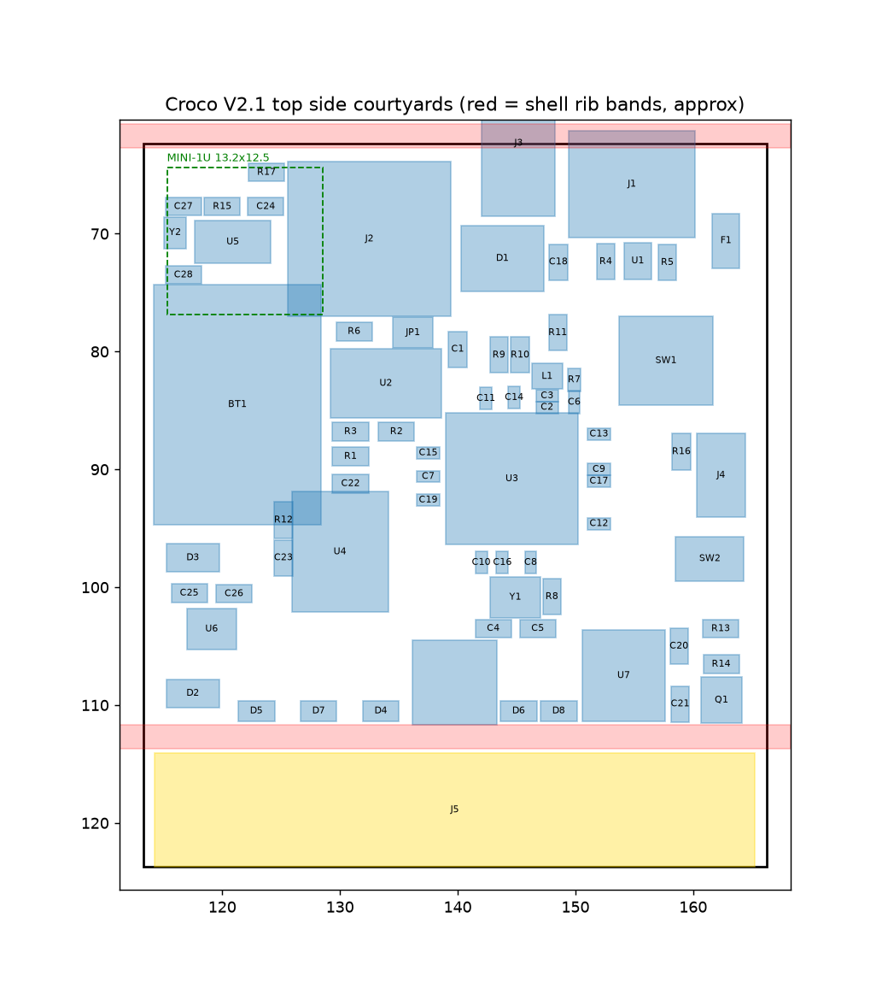

# Logbook: WiFi Game Boy cartridge, rock-solid revision

Running engineering log. Newest entries at the bottom. Every entry says what was done, what was found, why a decision was made, and what is still unverified.
Times are JST. (Corrected 04:58: the first entries were written with estimated times; all headings now match the git commit times.)

---

## 2026-10-14 04:04 Starting point

- Upstream: Staacks/wifi-game-boy-cartridge (2021). ESP8266 + 32KiB EEPROM + 74AHCT logic, two magic addresses (0x7FFE read, 0x7FFF write) mapped to the ESP.
- Upstream README: "The brown-out issues have never been resolved and this is more a proof of concept than a consumer product."
- Goal for this fork: a revision that is rock solid on every Game Boy and can be ordered fully assembled (JLCPCB PCBA). Nothing hand-soldered. Nothing gets ordered until simulation, design rule checks and a written test plan all pass.

## 2026-10-14 04:09 Fork

- Forked to hazy2go/wifi-game-boy-cartridge, `upstream` remote kept. Work happens on branch `redesign`.

## 2026-10-14 04:12 Audit of the original design

Method: parsed `pcb/wifi-gb-cart.kicad_pcb` (pad-to-net map), read the legacy schematic, BOM and every firmware file. Full findings in `docs/REDESIGN.md` section 1. The ones that matter most:

1. **Bulk capacitance on the wrong side of the regulator.** C5 680uF + C3 100uF sit on 3.3V after the NCP1117 linear regulator. A linear regulator draws from its input exactly what its output delivers, so every WiFi TX spike passes straight onto the Game Boy 5V. The caps only help once 5V has already sagged under ~4.4V (regulator dropout). This explains the author's "stable on fresh batteries only".
2. **Unlimited inrush.** Hot-plug or power-on charges ~780uF at the regulator's ~1A current limit straight from the console.
3. **Bus contention is possible in hardware.** The SN74LVC4245A transceiver direction is wired to A0 and its enable only to the address decode. /WR is not connected at all. Writing 0x7FFE makes the transceiver fight the CPU; any 0x7FFF access while ESP outputs are on shorts the 3.3V side.
4. **ESP boot-strap pins sit on the data bus** (GPIO0 = D0, GPIO2 = D2, GPIO15 = D7). A brown-out reset while the Game Boy touches 0x7FFF can strap the ESP into the wrong boot mode, so it hangs. Brown-out leads to reset leads to hang.
5. Firmware: no WiFi mode/TX power/sleep settings, ISRs mask interrupts and busy-wait with no guaranteed output-off timeout, open-drain pin init (D7 stuck low), samples taken after timed-out edge waits (ghost button presses), stack overflow in wiki.ino URL builder.
6. Board: no decoupling on U1-U5/U8/U9, top ground split into ~27 islands, status LED reversed.

## 2026-10-14 04:18 Prior art research

- Upstream issue #2 "Power instabilities" still open: 5V measured collapsing to ~3V on tired NiMH while the ESP boots. Author swapped NCP1117 for AP7361C (lower dropout), not confirmed as a fix.
- Upstream issue #6 (Jan 2026): author says he would design many things differently, BLE "might immediately solve the issue of brownouts", no further work planned.
- All 23 forks untouched. Nobody has fixed it.
- No documented current limit exists for the cartridge 5V pin on any Game Boy. DMG 5V is a crude transformer converter (2SD1664 + 4.7V zener feedback), not a regulated supply. Nintendo gave GBC rumble carts their own AAA battery. Croco Cartridge warns an overclocked RP2040 can already be too much for an original DMG.
- **Newer WiFi chips are worse on peaks, not better:** ESP8266 170mA, ESP32-C3 335mA, C6 354mA, S3 340mA, C5 up to 408mA, Pico W radio 271mA (all at 3.3V, datasheets). So the fix must be in the power path, not in the chip choice.

## 2026-10-14 04:26 Decision: Rev B (base on Croco Cartridge V2)

Options were Rev A (patch the Staacks design) or Rev B (start from Croco Cartridge V2 by shilga, add WiFi).

Chosen: **Rev B**. Why:
- Croco V2 is proven on real DMG and GBC hardware, open hardware (CERN-OHL-P v2), and already designed for JLCPCB assembly with LCSC part numbers.
- RP2350 serves the whole cartridge bus from PIO, so the fragile two-magic-byte EEPROM trick and its contention paths disappear. ROMs can be loaded over USB/WiFi instead of reprogramming an EEPROM.
- The only new risk is the radio + power stage, and that can be simulated before ordering.
- Cost: roughly $25-35 per assembled board vs ~$15 for Rev A. Worth it.

## 2026-10-14 04:27 Croco V2 board scan

Source: github.com/shilga/rp-gameboy-cartridge-hw, `KiCad/V2/GameboyCartridgeV2.1`.
- 4-layer board, outline 52.8 x 61.2 mm, 0.8mm thickness + ENIG recommended by the author.
- Contents: RP2350 (80QFN, RP2350B), W956A8MBYA5I HyperRAM, W25Q16JV flash, microSD, MCP79510 RTC + coin cell, USB-C, WS2812B LED, AP2112K-3.3 regulator, one TXB0108 level shifter, polyfuse F1, two Schottky diodes for USB/cartridge power OR-ing, TVS arrays on the bus.
- **Every component is on the top side.** The bottom side only has test points and logos. That is where the radio module and the power stage can go, without moving anything that already works.
- No bulk energy storage anywhere on V2.
- Open questions: free RP2350 GPIOs for an SPI link to the radio, shell clearance on the bottom side, antenna keep-out vs ground pours on a 4-layer board.

## 2026-10-14 04:27 Tooling

- Installed ngspice (brew) for the power simulation. KiCad 9 installing (cask) for ERC/DRC and BOM/CPL export from the command line.

## 2026-10-14 04:30 Power simulation, round 1 (plain limiter)

Built `sim/power/run_sim.py` (behavioural ngspice models, all assumptions in `sim/power/README.md`). Every run is a hot-plug into a running console, 2s, three radio load profiles, three console supply strengths.

- **Model sanity check passed:** the original design on a weak supply drags the console rail to 2.8V on hot-plug. Upstream issue #2 measured ~3V. Same failure, same size.
- Swapping the original's ESP8266 for an ESP32-C3 makes it much worse (tired console: 3ms below 4.5V becomes 353-747ms). Confirms "a newer chip alone is not a fix".
- A plain 150mA limiter + reservoir fixes fresh and tired consoles (rail never below 4.63V) but **fails on a weak console**: the rail sits at 4.39V the whole time, because 100mA console + 60mA Croco + 150mA radio is too much for a weak supply.

## 2026-10-14 04:32 Round 2: input-voltage regulation (DPM)

Idea taken from solar/USB battery chargers: instead of a fixed current, the cartridge only takes what the console can give while its rail stays above a threshold.
- With fold-back at 4.6V: console rail never below 4.62V in all 9 cases. But on a weak console the radio starved: reservoir fell to 2.05V, radio nearly lost power.
- Added a firmware power-save state (radio drops to modem-sleep when the reservoir is low). Still starved at 4.6V; at 4.5V fold-back there is enough headroom.

## 2026-10-14 04:34 Round 3: throttle thresholds (the non-obvious one)

- With the firmware throttle at 3.0V the reservoir lived at ~3V. A linear current limiter delivers I x V(reservoir) into the cap and burns the rest, so at 3V it only delivers ~60% of what it takes from the console. Throughput was capped at 79% on busy traffic.
- Raised throttle to 4.0V and power-save to 3.5V: the reservoir lives near 4-4.5V where the limiter is efficient. Busy-traffic throughput went to **99%** at the same 150mA.

**Result with the full design (150mA limit + 4.5V fold-back + 4.0V throttle + 3.5V power-save):**
- Console rail never below 4.5V in any of 9 scenarios (fresh 4.78V, tired 4.63V, weak 4.54V min). The original dropped to 4.23 / 3.67 / 2.80V.
- Radio never browns out (reservoir never below 3.5V after power-good).
- Throughput fresh/tired: 99% busy traffic, 72-80% worst-case 802.11b, 62% artificial stress. Weak console: radio stays connected in modem-sleep but sends almost nothing. The game never crashes, which is the trade we want.

Still unverified (needs real hardware): actual console supply impedance, Croco's real current, ESP32-C3 modem-sleep average, real fold-back circuit behaviour. A part search for a buildable fold-back circuit is running.

## 2026-10-14 04:37 Finding a real chip for the fold-back

Part search (datasheets downloaded, stock from JLC's API):
- **BQ24075** (TI Li-ion charger with power path, C15464, 16.7k in stock, ~$1.07). Has a VIN-DPM loop: below 4.5V typ (4.35 min, 4.63 max) on its input it cuts current. Checked in the datasheet text: VIN-DPM is only active in USB100/USB500 modes (EN2 low). Resistor-ILIM mode has no DPM. Used with charging disabled (CE high) and BAT switch off (SYSOFF high), its OUT pin is simply a current-limited, input-regulated supply for our reservoir.
- Caveat: datasheet recommends 4.7-47uF on OUT; we put ~1.4mF there. Soft-start charges OUT at 100mA until 0.9V, then the selected limit. Expected fine, must be bench-tested.
- TPS2553 ILIM cannot be used for fold-back (sinking current from ILIM *raises* the limit; ILIM resistor range 15-232k for loop stability).
- Discrete op-amp/TLV431 + PMOS fold-back = fallback (loop compensation unverified).
- MCP73871 (VPCC adjustable) rejected: VPCC only cuts battery charging, load on OUT is unprotected.
- Rejected for stock/specs: BQ25173 (no VINDPM, 0 stock), BQ25185 (100uF max on SYS), LTC4041/LTC3226 (cost/stock), MAX38889, BQ25190, BQ25504/BQ25570.

## 2026-10-14 04:39 Power simulation, round 4: real BQ24075 behaviour + tolerance corners

Ran the BQ24075 alone in both modes and then the combination:
- USB100 alone (95mA): console safe, but only 34% of busy-traffic airtime. Too little.
- USB500 alone (500mA + DPM): 100% airtime, but on a fresh console the rail rides down to ~4.59V on every burst (0.3-0.4V ripple on the console supply = speaker noise risk, the original's audio static complaint).
- **Chosen: TPS2553 at 150mA in front of BQ24075 in USB500.** The TPS2553 gives a smooth constant ceiling, the BQ24075 a guaranteed input-voltage loop. Typical part: identical to the idealised design (fresh/tired 99% airtime, rail >= 4.63V; weak rail 4.52V).
- Tolerance corners exposed two weak-console problems:
  - DPM at 4.35V (min): rail sat at 4.39V for most of the run.
  - DPM at 4.63V (max): radio starved, reservoir fell to 2.06V, radio power-good cycling.
- Fixes: (1) radio firmware also watches the cart rail on its ADC and backs off below 4.55V, (2) precision 4.45V comparator gating the charge path as a hard floor (instead of the 4.38V APX803).
- Result: worst corner is now a single 57ms dip to 4.46V right at plug-in on a weak console with a min-tolerance BQ24075, then >= 4.5V. Max-tolerance corner on a weak console: radio parks/cycles, console unaffected. Firmware rule added: if the reservoir falls below 3.0V the radio goes to deep sleep and retries later, instead of cycling.

## 2026-10-14 04:41 How the radio connects to Croco

- Mapped every RP2350B pin from the Croco V2 PCB netlist: **all 48 GPIOs are used** (GB bus 17-45, HyperRAM 6-16, SPI0 + SD/RTC 0-3/5, button 4, debug UART TX 46, WS2812 LED 47).
- Croco V2 firmware is Rust/Embassy (shilga/rp2350-gameboy-cartridge-firmware, GPL-3). GPIO46 is only defmt-serial logging.
- Croco power path (from netlist): cart VCC -> D2 Schottky -> +5V -> AP2112 3.3V; USB VBUS -> F1 -> D3 -> +5V. **The new power stage must tap raw VCC before D2**, otherwise the DPM loop sees ~0.3V less and folds back on healthy consoles.
- Decision: ESP32-C3 as an SPI slave on the existing SPI0 bus with chip select on GPIO46 (debug logging moves to defmt-RTT over the existing SWD Tag-Connect). MISO through a 74LVC1G125 tri-state buffer gated by that chip select. RP2350 polls, no IRQ line. Keeps LED, RTC and SD untouched.
- Power mux (prefers USB) in front of the stage so the radio works and can be flashed on USB alone.
- Radio flashing without soldering: ESP32-C3 native USB; preferred a USB hub chip behind the USB-C (both chips enumerate), fallback analog USB switch + slide switch.
- Details: `docs/ARCHITECTURE.md`.

## 2026-10-14 04:43 KiCad baseline

- KiCad 10.0.6 installed. Ran ERC/DRC on the **unmodified** Croco V2.1 files to have a baseline before touching anything.
- DRC (zones refilled): 199 solder-mask bridges, 107 clearance, 15 shorting items, 10 via diameter, 4 hole clearance, 3 unconnected, 2 items-not-allowed. ERC: 262 (mostly library/symbol link issues from opening a KiCad 8/9 project in 10).
- Spot checks: the "shorts" are copper graphics inside footprints (SW1 soft button, J5 edge connector polygon); clearance hits use KiCad 10's default 0.2mm board minimum, Croco was designed to tighter JLC 4-layer rules. These boards were ordered and work, so most of this is rule configuration, not real defects.
- Next: set an explicit JLC 4-layer rule set, re-run, and triage what is left into real vs. artefact **before** adding anything, so every new violation is ours.

## 2026-10-14 04:44 Open mechanical question: does anything fit on the bottom?

- A cartridge shell has limited interior depth. The coin-cell holder, USB-C and microSD on the top side set where the PCB sits. If the bottom only has ~1mm, a 2.4mm-thick ESP32-C3-MINI-1 does not fit there.
- Antenna: a PCB antenna needs a copper keep-out on all 4 layers and must sit in the part of the cart that sticks out of the console. The top edge of Croco V2 is crowded (USB-C, microSD, LED, RTC crystal). Leaning towards ESP32-C3-MINI-1U (u.FL) + a stick-on FPC antenna in the shell's label area: plugs in, no soldering.
- Research on shell clearances and stock for the remaining parts (power mux, USB hub, buffer, low-profile reservoir caps, MINI-1U, antenna) is running.

## 2026-10-14 04:54 Mechanical result: the bottom side is unusable (plan change)

Measured a community 3D model of an original-style DMG shell (Printables #804399, ±0.2mm, cross-checked against Wikipedia's 65.5 x 57 x 7.5mm):
- Back wall ~1.15mm, front (label) wall ~2.0mm, interior cavity 4.65mm (5.3mm near the connector).
- Full-width ribs on the label half come down to 2.5mm, at the shoulder and at the top edge, forming a 1.35mm slot the PCB sits in.
- Croco's 3.38mm coin-cell holder only fits on the rib side, so Croco's top side faces the label half and its **bottom side lies on the back wall: ~0mm usable, 0.55mm at best**. Even cutting a window through the back wall gives ~1.7mm, less than the module's 2.55mm max.
- Top side budget 3.3-3.85mm: a 2.4mm module fits in height, but a 2mm occupancy grid of Croco's top side shows **no free 13 x 17mm area**.
- Precedent: Staacks used a 1.6mm PCB and a modified 3D-printed shell and wrote he doubted it fits any normal cartridge.

**Conclusion: the earlier "put the radio on the empty bottom side" plan is dead.** The radio must go on the top side, which means changing Croco's top layout.

Other findings from the same search:
- 6TPE470MI reservoir caps are **3.8mm tall**, too tall for either side. Low-profile replacements: 6TPE330MAP (330uF, 1.8mm, 25 mOhm, C79112) or 6TPE220MI (220uF, 1.8mm, 18 mOhm, C129173). Reservoir has to be re-simulated with the smaller total.
- Stock (JLC API): ESP32-C3-MINI-1U-N4 C2911374 (1740), MINI-1-N4 C2838502 (8243), TPS2116DRLR power mux C3235557 (72k), CH334P USB hub C5373042 (28k, crystal optional per datasheet), TS3USB221 C128396, SN74LVC1G125 C23654, TLV431A C56765, u.FL U.FL-R-SMT-1 C88374. FPC antennas are not JLC-assembled (plug-in after delivery).
- Bare ESP32-C3FH4 QFN (0.9mm): JLC 13k stock but LCSC 0; needs our own RF matching network. Higher risk than a certified module.

Candidate ways to make room on the top side (decision pending with Hazy):
1. Replace the CR1220 coin-cell holder (largest top part, ~13 x 15mm footprint) with a small SMD rechargeable cell (e.g. ML621) and resync the clock over WiFi (NTP). Put the ESP32-C3-MINI-1U where the holder was, u.FL cable to a stick-on antenna in the shell's grip end.
2. Keep the coin cell, relayout the whole top side tighter (high effort, high risk on a proven board).
3. Bare ESP32-C3 chip with our own RF design (smallest, riskiest).

## 2026-10-14 04:57 Decision: option 2, keep the coin cell, relayout the top side (Hazy)

- Hazy chose to keep the CR1220 coin cell (clock retention for years) and relayout Croco's top side to fit the radio + power stage.
- Area budget from the board file (KiCad pcbnew API, courtyard areas, top side): board 52.95 x 61.34mm. Edge connector region ~540mm2. Existing top parts excluding the connector ~1370mm2 of ~2650mm2 usable (52%). New parts estimate ~520mm2 courtyard (MINI-1U ~190, 3 reservoir caps ~110, BQ24075/TPS2553/TPS63802/mux/hub/buffer + passives ~220). After: ~71% density. Tight but realistic for 4 layers with 0402 passives.
- Layout constraints to respect: top-side height 3.3-3.85mm, shell ribs at ~11mm and ~62mm from the connector end (keep tall parts out of those bands, Croco already does), antenna cable to the grip end.

## 2026-10-14 04:59 Power simulation, round 5: low-profile reservoir

The 3.8mm-tall 6TPE470MI does not fit, so re-ran the chosen design with 1.8mm-tall 6TPE330MAP (330uF, 25 mOhm) in parallel:

| caps | radio up after plug-in | busy traffic | worst 802.11b (fresh/tired) | stress | console rail |
|---|---|---|---|---|---|
| 2x 330uF | 18ms | 99% | 54% / 50% | 63% | unchanged |
| **3x 330uF** | 27ms | 99% | 65% / 59% | 62% | unchanged |
| 4x 330uF | 37ms | 99% | 76% / 68% | 62% | unchanged |

- Console safety does not depend on reservoir size at all (the limiter and the DPM loop decide that). Reservoir size only buys airtime for the long 12ms 802.11b frames.
- **Chosen: 3x 6TPE330MAP (~1mF).** Firmware will disable 802.11b rates (`esp_wifi_config_11b_rate`), which removes the 12ms frames that need the big reservoir in the first place.

## 2026-10-14 05:00 Schematic tooling

- Several new parts have no KiCad library symbol (TPS2553, TPS63802, ESP32-C3-MINI-1U, the comparator). Present in KiCad 10: TPS2116DRL, BQ24075RGT, CH334F/R, SN74LVC1G125DBV.
- Decision: the radio sheet is **generated** from one machine-readable netlist (`docs/design/netlist_radio.json`) by `hw/rev-b/tools/gen_radio_sheet.py`. Every pin gets a label, power symbol or no-connect marker; a pin missing from the JSON is a hard error. The same JSON will drive footprint/net assignment on the PCB, and KiCad's DRC schematic-parity check will prove the two match. Why: no hand-drawn wire can silently miss a pin, and the design is reviewable as a table.
- `tools/add_radio_sheet.py` adds the "Radio" hierarchical sheet to Croco's root schematic once (fixed sheet UUID so references stay stable across regenerations).
- Smoke test on a copy with 3 parts: sheet loads in KiCad 10, ERC runs and reports exactly the expected undriven-input errors for the test parts.
- A datasheet-level design pass (pin tables, component values with equations and citations, LCSC numbers, footprints) is running and will produce the JSON.

## 2026-10-14 05:02 Top-side occupancy map

- Rendered every top-side courtyard from the board file, with the approximate shell rib bands (red) and a 13.2 x 12.5mm MINI-1U outline for scale.
- Candidate areas: right column around SW1/J4/SW2 (x 150-166, y 76-100), lower-left around D2/D3/U6/C25/C26 (x 113-125, y 95-112), and the top-center if the debug header J3 goes (GPIO46 becomes the ESP chip select, so the UART header has no job left).
- Constraint: Croco's HyperRAM (U4) and RP2350 (U3) routing is the timing-critical core. The relayout should move peripheral parts and leave the U3/U4/U2/Y1 core routing untouched.

## 2026-10-14 05:04 Layout tooling

- Installed OpenJDK 21 and Freerouting 2.5.0 (jar, `~/Projects/tools`). Plan: lock Croco's existing core routing, export Specctra DSN from pcbnew, autoroute only the new and moved nets headless, import the session, then DRC + schematic parity. Every autorouted net gets reviewed against the board's rules before it is accepted.
- Logbook rule from now on: every heading time comes from the system clock at the moment of writing (two entries had been written with guessed times and were corrected).

## 2026-10-14 05:22 Audit loop (Hazy: "audit loop every test, simulate, emulate")

New rule for the rest of the project: **every result gets a scripted check with a pass/fail limit, and an independent second way of getting the same number.** A result that has not passed its audit is not reported as a result. Harness lives in `verify/` and `sim/power/audit.py`.

### What the audit is made of

| id | check | how it is independent |
|---|---|---|
| A1 | ngspice vs `sim/power/pyref.py` on the chosen design, 3 consoles x 3 profiles | pyref is a fresh fixed-step integrator written from the circuit equations; shares only parameter values with the SPICE netlists |
| A2 | ngspice at 20us vs 5us max step | catches timestep artefacts |
| A3 | console-rail floor vs closed-form steady state | pencil-and-paper algebra |
| A4 | energy sanity (source energy > radio energy) | conservation |
| A5 | realistic firmware across tolerance corners | see below |
| K1 | KiCad ERC/DRC/parity vs recorded baseline of unmodified Croco V2.1 (`verify/kicad_check.py`) | fingerprints every violation; any new one fails |

The KiCad gate was itself tested: deleting one track segment in a scratch copy made it FAIL with 2 new clearance violations (mutation test). A gate that cannot fail is not a gate.

### A1-A4 result: the math was right

- A1: ngspice and pyref agree to <= 0.2 mV on the console minimum, <= 0.3 points on TX airtime, <= 0.02 ms on radio start. All 27 checks PASS.
- A2: 20us vs 5us: <= 0.3 mV, <= 0.05 points. PASS.
- A3: console floor 4.783 / 4.628 / 4.516 V (fresh/tired/weak), identical to the closed-form solution. PASS.
- A4: PASS.

### Problems the audit found in my own earlier work

1. **Tolerance corners were run on the wrong reservoir.** `final_lo`/`final_hi` used the old 1.41 mF bank, not the 0.99 mF (3x 330uF) bank that was chosen at 04:59.
2. **A hidden failure in the committed results.** Weak console + DPM at its 4.63 V maximum: reservoir minimum 2.06 V, i.e. the radio was sitting on its power-good cut-off. It was in `results.txt` but I did not call it out.
3. **`results.txt` was not reproducible** from the committed script (a duplicated `final` row from an earlier variant list). Will be regenerated by the harness.
4. **The SPICE firmware model was too kind.** It throttles TX continuously, i.e. it can stop a WiFi frame half way. A real radio cannot. It also throttled the boot RF calibration, which is not throttleable.

### Datasheet audit (sub-agent, primary sources)

- TPS2553 "150 mA" (RILIM 180k) is really **129 / 150 / 174 mA** (datasheet Eq. 1 min/nom/max). Corner sweep now uses 129-174 mA.
- TPS2553 does **not** block reverse current instantly (3-7 ms deglitch). Reverse blocking has to come from the stage after it.
- **BQ24075 VIN-DPM only works in USB100/USB500 mode** (EN2 low); in ILIM-resistor mode there is no input-voltage regulation. USB500 behind the 150 mA TPS2553 is fine (that is TI's own Fig 9-3 case), but:
  - VIN-DPM is 4.35 / 4.50 / 4.63 V. At the 4.35 V corner a weak console sits at ~4.45 V while the reservoir charges.
  - It is a Li-ion charger used without a battery. Datasheet says it runs with an absent battery but runs a 250 ms battery-detection cycle forever; the sleep comparator (VIN > VBAT + 55-130 mV, BAT near 4.2 V with no cell) is only ~0.15 V above the DPM minimum. Thin.
  - Input FET drop implies 0.3-0.48 ohm (no RDS(on) given). Corner sweep now uses 0.2-0.6 ohm total switch path.
- ESP32-C3-MINI-1U: TX peak **350 mA** (11b 20.5 dBm), 295 mA (11g), RX 82-84 mA, modem-sleep 13-28 mA, light-sleep 130 uA. Datasheet wants a supply able to deliver >= 0.5 A (the reservoir + buck-boost provides the peak, the input does not).
- TPS63802: starts above 1.8 V, runs down to 1.3 V; ~91-94 % efficient at 3.6-4.2 V in, 300 mA out (read from curves). 0.88 was conservative.
- 6TPE330MAP: 330 uF, 25 mOhm, 1.8 mm, 6.3 V (79 % of rating on a 5 V rail), leakage up to 208 uA each.
- No published current budget for the cartridge slot on any Game Boy. Pan Docs: whole DMG is ~0.7 W. **Our 150 mA at 5 V is about the same power as the entire console.** This is the strongest argument for keeping the limit low.

### A5: firmware as a state machine (pyref.simulate_fw)

Radio states OFF / BOOT (RF calibration, uninterruptible) / RUN / SLEEP / PARK, all decisions from a 1 ms ADC sample, frames admitted only if the reservoir is predicted to stay above 3.0 V at the end of the frame, never aborted. Uncontrolled reset = reservoir falls through power-good (2.0 V) while the radio is on.

Findings:
- **Console safety holds on fresh and tired consoles in every corner** (129-174 mA, DPM 4.35-4.63 V, logic 40-100 mA, efficiency 0.80-0.92, switch path 0.2-0.6 ohm, three traffic profiles).
- **Weak console at the DPM 4.35 V corner: console sits at 4.46 V** for as long as the reservoir is charging. That is below the 4.5 V line. Root cause is the BQ24075 tolerance, not the topology.
- **The RF calibration at WiFi start decides whether the radio survives.** Usable reservoir energy 4.2 -> 2.0 V is 6.75 mJ. A TX-heavy calibration phase at 50 % duty drains it in ~13 ms at the worst corner and ~37 ms at nominal. Calibration of 5 ms is fine, 20 ms at 50 % causes a controlled park on fresh consoles and reset loops on weak ones. The real calibration current profile of the ESP32-C3 is the number that matters most now; research running.
- The 12 ms 802.11b frames are not survivable with this reservoir under realistic gating (radio reset loops at the low-current corner). **Firmware must disable 11b rates and A-MPDU TX** (frames <= ~2.5 ms). This becomes a hard firmware requirement, not an optimisation.

## 2026-10-14 05:29 Firmware co-simulation (the "emulate" part) and research results

### The real firmware is now in the loop
- `firmware/esp32c3/components/power_mgr/power_mgr.{c,h}`: the radio power manager as plain C (no ESP-IDF dependency). This is the code that will ship on the ESP32-C3.
- `sim/power/cosim.py` compiles it for the host (`cc -Wall -Wextra -Werror -std=c11`), calls it through ctypes on every 1 ms ADC tick, and integrates the analog power path between ticks.
- **A6**: the shipped C code and the independent Python model of the same spec (`pyref.simulate_fw`) must agree on console minimum (5 mV), TX airtime (3 points), reservoir minimum (30 mV), time below 4.5 V (5 ms) and on whether the radio resets. **36/36 PASS** over 3 consoles x 4 traffic types x 3 tolerance corners.

### Bugs the cross-check found (both models had them, in different places)
1. **RUN/SLEEP chattered every millisecond on a weak console.** The cart-rail watch had no hysteresis, so the firmware flipped state on every ADC tick and the results depended on sample phase (C and Python disagreed by up to 93 points of TX airtime). Fix in the firmware: sleep below 4.55 V, resume above 4.60 V.
2. **Python model admitted frames late.** If a burst started while in SLEEP and the state changed to RUN 1 ms later, it started a frame mid-burst. The C code only decides at the start. Python fixed to match the spec.
3. **Python counted calibration pulses as delivered traffic.** Metric fixed.
4. The reservoir-minimum metric was dominated by the power-up moment, not by traffic. Both models now measure it over the traffic window.

### Research results (primary sources, sub-agent)
- ESP-IDF: **full RF calibration takes 100 ms longer than partial**; partial (default) reuses full-calibration data stored in NVS. No published current profile or duration for partial calibration on the C3.
- ESP32-C3 auto light-sleep with DTIM1 averages **1.4 mA** (modem-sleep 21.5 mA). Light-sleep is the better SLEEP mode for weak consoles.
- **802.11b cannot be fully switched off.** `esp_wifi_config_11b_rate` disables 11b data rates, but an open ESP-IDF issue (#19164) shows a station still sending at 1/2/5.5 Mbps, and management frames go out at 1 Mbps. So the 1 Mbps fallback has to be handled by **limiting frame size** (MTU/MSS), not just by configuration.
- Open issue #17881: a brown-out during TX on a C3 can leave the RF stuck on after reset. Our power-good gate removes the radio's supply completely below 2.0 V, which is the right response to that bug. It is another reason the design must never let the radio brown out.
- Input-voltage-regulation parts: no off-the-shelf part guarantees +-1.5 %. Best found: MP2617A (switching charger, +-2 % reference), BQ24251 (I2C, +-2 %, 0 stock), BQ25601 (I2C, +-3 %).

### A5/A7 results with the C firmware and the datasheet corners
- Fresh and tired consoles: console never below 4.5 V and **zero uncontrolled radio resets** in every corner (ilim 129-174 mA, DPM 4.35-4.63 V, logic 40-100 mA, efficiency 0.80-0.92, switch path 0.2-0.6 ohm, 4 traffic types).
- Weak console: zero radio resets; console safe in every corner **except DPM at the 4.35 V minimum** (4.45 V for up to 1.1 s while the reservoir charges). That is the one remaining FAIL and it belongs to the BQ24075's tolerance.
- **Calibration budget (A7): the radio survives up to 10 ms of calibration at 50 % TX duty at the worst corner.** Requirements that follow:
  - do the first full calibration on USB power (when flashing) and store it in NVS; the cart slot must never see a full calibration;
  - measure the partial-calibration current profile on a dev board before ordering. Pass if it is below the 10 ms @ 50 % energy (about 7 mJ above the input supply).
- With forced 1 Mbps frames of 4.5 ms (536-byte MSS) the admission rule refuses everything at the worst corner (it assumes no input during the frame). **MSS has to come down to about 300 bytes** for the 1 Mbps fallback case, or the admission rule must count the guaranteed input current. To do in the firmware.

## 2026-10-14 06:03 Replacing the BQ24075: precision input-voltage regulator, transistor level

### Why
The BQ24075 was the only A5 failure (weak console at its 4.35 V VIN-DPM minimum). It is also a Li-ion charger running without a battery (endless 250 ms battery-detect cycle, sleep comparator ~0.15 V above the DPM minimum). Research found no stocked part with a resistor-set threshold better than +-2 %. So: a discrete loop.

### Circuit (sim/power/inreg.py)
`VMUX -> TPS2553 (150 mA) -> back-to-back PMOS pair (Vishay SiA975DJ dual, C141597) -> VRES`. A TLV431B (0.5 %, C398375) watches VMUX through 27.0k/10.0k (set-point 1.24 x 3.7 = 4.588 V) and pulls the shared gate down when the console rail is above the set-point. Back-to-back so neither the reservoir nor USB can ever feed the cart rail. The divider senses the mux output, so on USB power the regulator is simply fully on.

### Vendor models (sim/models/)
- A helper downloaded TI's TLV431 (SLIM005), TPS2553 (SLVM425), TPS63802 (SLVMCX1) and Vishay SiA975DJ / Si2371EDS models and checked each against its datasheet: TLV431 1.2409 V and 0.251 ohm dynamic impedance (datasheet 1.240 V, 0.25 ohm); SiA975DJ 54.8 mOhm at -2.5 V (datasheet 49 typ / 60 max); TPS2553 limit 1.288 A at 20k (equation 1.28 A).
- Two TI models were silently broken in ngspice: PSpice's boolean XOR `^` is the power operator in ngspice, which disabled the TPS2553 a millisecond after start; the TPS63802 one-shot had a zero-delay loop. Both patched, documented.
- Model caveat: the TLV431 model's regulation knee is too soft below ~0.5 mA (sinks current slightly below the threshold). Pessimistic for us; designs are kept in the >0.5 mA region.
- **Licence:** TI/Vishay allow simulation use, not public redistribution. The repo is public, so the vendor files are git-ignored and `sim/models/fetch_models.py` downloads them, checks SHA-256 and applies the patches. Audited: its output is line-for-line identical to the hand-patched files.

### Results so far
- DC: regulates the console at **4.589-4.598 V** from weak (2.5 ohm) to tired-plus (1.4 ohm) consoles (load regulation 9 mV). Fresh and tired consoles are above the set-point at the full 150 mA, so the regulator is simply fully on there.
- Loop gain (Middlebrook injection between VMUX and the divider, where the impedance ratio is ~37k : 1 ohm): with Cc = 10 nF from cathode to REF, crossover 14-390 Hz, **phase margin 69-85 deg**, gain margin > 57 dB across console impedance 1.4-2.55 ohm and console capacitance 47-220 uF.
- Bug in my own harness, caught by a nonsense result: the DC operating point converged to VCC = 1.09 V for one variant, and the AC analysis was then computed around that garbage point (it showed PM "999"). Fix: `.nodeset` initial guess, and every operating point is checked for plausibility.

### Problem found: integrator wind-up
New transient tests (cart-side soft start modelled: TPS2116 1 ms, TPS2553 1.5 ms rise):
1. **Hot-plug on a weak console:** VCC dips to 4.38 V (R = 2.0 ohm) for ~4 ms.
2. **Burst after idle (worse, it happens in normal use):** when the reservoir is full no current flows, the console looks healthy, so the TLV431 integrator winds all the way to "fully on" (cathode at 0 V, Cc charged the wrong way). The next radio burst drains the reservoir, the full 150 mA flows instantly, and the loop needs 3-5 ms to unwind. VCC 4.38 V at 2.0 ohm, 4.29 V at 2.3 ohm.

What did not fix it (all simulated, numbers in `sim/power/inreg_search.py` history):
- TPS2553 enable delay (15 ms): no change, the wind-up happens anyway.
- Bias resistor from VMUX to the cathode: no change.
- Faster/larger proportional term (Rc up to 2.2 M): hot-plug improves but phase margin collapses to 14-38 deg, and crossover moves to 14-74 kHz where the TLV431 macro-model is least trustworthy. Rejected.
- Gate capacitor as the dominant pole instead of Cc: unstable (negative phase margin).

**What works: anti-wind-up clamp.** Move the integrator capacitor to the gate node and clamp the gate to at most ~2 diode drops below the source. The integrator can then only wind up to "just fully on" (~0.4 V of extra swing instead of ~3.4 V), and the TLV431's current in saturation is bounded by Rk. First results: burst-after-idle +17 to +74 mV margin (was -213 mV), hot-plug +8 mV with Rk 2.2k / Cc 2.2 nF; phase margin 42 deg there, just under my 45 deg rule. Fine-tuning Rk/Cc/Rc now.

## 2026-10-14 06:20 A8: formal regulator audit of the anti-wind-up candidate (Rk 2.2k, Cc 2.2n on gate, Rc 10k, 2-diode clamp)

`sim/power/audit_inreg.py`, ~140 corners (console 1.4-3.0 ohm and 47-220 uF, Cc +-10 %, Rk/Rc +-1 %). **58 FAIL. Not accepted.** What it found:
1. **The clamp starves the charger.** Two diodes clamp the gate to about -1.2 V, which on the SiA975DJ only passes ~70 mA when the reservoir is low (FET in saturation, 0.6 V overdrive). At 1.4 and 1.8 ohm the console sits at 4.67 V instead of 4.59 V, i.e. the "regulator" is stuck on the clamp, loop gain -55 dB. Safe for the console, but it would halve the radio's power on fresh consoles. The clamp needs to sit near -1.5 V (enough overdrive for 150 mA, little extra wind-up).
2. **Hot-plug on the weakest consoles (2.5 ohm with 47 uF, 3.0 ohm):** dips 7-82 mV under the limit. At 3.0 ohm the console alone is below the set-point, so the regulator should never turn on. Suspect the TLV431 model's soft knee (it sinks current 1.5 % below the threshold, the real part does not). Needs a cross-check with an independent TLV431 model before I believe either way.
3. Passed: set-point accuracy where it regulates (+0.03 to +0.42 %), all operating points plausible, worst phase margin 46 deg, burst-after-idle +79 to +137 mV everywhere it applies.

Next: clamp at ~1.5 V (diode + resistor, or a red LED as a 1.6 V knee), second TLV431 model for cross-check, re-run A8.

## 2026-10-14 08:13 Resume after the 06:2x run died; A8 re-run on the work-in-progress design

The agent run that was doing the A8 corner audit died mid-way (orchestration failure, not a sim failure). Uncommitted work found on disk and kept:
- **3-diode gate clamp** (was 2): gate can swing ~1.8 V below the source, enough overdrive for 150 mA (the 06:20 finding that 2 diodes starve the charger at ~70 mA).
- **Power-on hold:** a 100 nF / 470k pulse from VMUX turns a small NMOS on that pulls REF low, so after hot-plug the loop starts from "off" and engages as the pulse decays. Generic NMOS model for now (VTO 1.8 V); needs a real part model before layout.
- **TI's TPS2553 transient model** now used in hot-plug/burst transients (behavioural model kept for DC/AC, where the vendor model's operating point does not converge). Vendor 149 mA vs behavioural 150 mA at RILIM 180k.
- Harness: a transient that stops early (truncated .dat) now raises instead of being analysed; "Timestep too small" and "aborted" count as failures.

Re-ran A8 on it (`out/audit_inreg.log`):
- **A8.4 hot-plug: all PASS** now, including 3.0 ohm consoles (+5.0 mV worst, was -82 mV). The power-on hold fixed it.
- **A8.3: 24 FAIL, all gain margin at 1.4 ohm (1.1-4.4 dB).** Phase margin is fine (worst 45.8 deg). The cause: a sharp peak in the loop gain at ~330 kHz with a 180 deg phase flip. There is no inductor anywhere in the netlist, so this is an active minor loop: TLV431 -> Rk -> gate -> Cc -> Rc -> REF, i.e. the TLV431 inside its own local feedback.

### New finding the audit did not check: the TLV431 is outside its datasheet range
Looking at why the minor loop rings, the operating points show the **TLV431 cathode at 0.11-1.30 V while regulating** (1.4 ohm: 0.11-0.14 V). The datasheet minimum cathode voltage is Vref (1.24 V). Below that the part is saturated and its gain is not specified, so every regulation, stability and wind-up result in that region relies on macro-model behaviour outside the region it was fitted for.
Cause: cathode = gate - Ik*Rk with Ik = Vsg/Rg, so the cathode sits at Vs - Vsg*(1 + Rk/Rg). With Rk 2.2k / Rg 680 and Vsg ~1.04 V that is ~4.2 V below the source.
- New hard constraint: Vka >= Vref + 0.2 V at every regulating operating point, i.e. Rk/Rg <= ~1.9. To be added to A8 as A8.6.
- Harness changes for this: AC sweep 50 -> 200 points/decade (50 can step over a sharp peak and miss a 0 dB crossing), per-process AC/DC file names (two sims running at once could read each other's output).
- Search `sim/power/inreg_vka.py` over Rg 680/1k/1.5k, Rk 470/680/1k, Cc 2.2/4.7 nF with the Vka constraint, gain margin, phase margin, hot-plug and burst-after-idle. Running.

## 2026-10-14 08:19 Stability: two bugs in my own checker, and AC vs time domain disagree

### A8 result on the work-in-progress design (`sim/power/out/audit_inreg_wip_0813.log`)
22 FAIL, all A8.3 (gain margin 1.1-4.4 dB at 1.4 ohm). A8.4 hot-plug and A8.5 burst-after-idle: all PASS.

### Checker bug 1: only the first 0 dB crossing was looked at
`inreg.loop_gain` took the first 0 dB crossing for phase margin and the first -180 deg crossing for gain margin. Re-sampled at 200 points/decade, the 324 kHz peak at 1.4 ohm is **+15.9 dB**, not -1 dB: the loop gain crosses 0 dB a second time with the phase through -180 deg. That is an oscillator, and the old code reported PM 62-92 deg / GM 1-4 dB. Fixed: PM is now the worst over every 0 dB crossing (angular distance from -180 deg, conservative), GM the worst over every -180 deg (mod 360) crossing, negative meaning unstable.
Diagnosis of the peak (`out/inreg_vka_round1.log` and ad-hoc runs): unaffected by the power-on hold, Rk (470 vs 2.2k gives identical numbers) or console capacitance; strongly affected by the mux/switch resistances (70 -> 200 mOhm: +15.9 -> +1 dB) and by Rg (2k: -1.3 dB). It is the high-frequency plateau of the loop (above ~60 kHz Cc is a short, the TLV431 + Rc form a proportional stage) meeting a resonance inside the TLV431/FET models.

### Checker bug 2: the AC result alone is not trustworthy here
New time-domain test `sim/power/inreg_ring.py`: reservoir held at 3.0 V like the AC analysis, regulator settled, 10 mA console load step, then the gate voltage's content above 20 kHz (Hann-windowed FFT, so slow settling at the 1 kHz crossover does not count).
- Every candidate oscillates at 1.4 ohm: current design 28 mV p-p at 320 kHz; Cc 4.7n (clean in AC, GM +18.7 dB) 30 mV; Rg 2k (peak -1.3 dB in AC) **222 mV at 225 kHz**; Rg 1.5k / Rk 1k 313 mV at 247 kHz.
- Not numerical: gear 20 ns / reltol 1e-4, trap 5 ns / 1e-5 and gear 2 ns / 1e-6 give the same 636 mV at 265 kHz for one case.
- The console rail barely sees it (< 0.6 mV), so it would not crash a Game Boy, but a regulator that oscillates is not acceptable: it is a sign the loop is wrong somewhere, it radiates next to a 2.4 GHz radio front-end, and it can change character with real part spread.
- Quick scan at 1.4 ohm: Rc 0 still rings (179 mV), a cap on REF makes it worse (lower frequency, larger), **Rg = Rk = 4.7k or a 47 nF gate-source capacitor stop it completely**.
- So the ring test is a gate of its own. Search round 3 (`inreg_vka.py`): Rg 1.5k/2.2k, Rk 1k/2.2k, Cc 2.2/3.3 nF, Cg 10/22/47 nF, gated on Vka, GM >= 10 dB over all crossings, ring < 5 mV over 5 console impedances x 2 capacitances, then PM/hot-plug/burst. Running.

## 2026-10-14 08:27 The oscillation is real; round 3 fails everywhere; root cause and two fixes

### Round 3 (`out/inreg_vka.log`): 24/24 rejected
Rg 1.5k/2.2k x Rk 1k/2.2k x Cc 2.2/3.3n x Cg 10/22/47n. Cathode now in range everywhere (1.96-3.02 V), but gain margin -13 to +5 dB and gate ringing 8-320 mV in every combination. Rk changes nothing in AC (identical GM for 1k and 2.2k), larger Rg makes the ringing worse.

### Is it the model? Two suspects eliminated
1. **The behavioural TPS2553** (ideal instantaneous current limit) could fight the regulator. Raising its limit to 0.5 A so it never limits: still rings (146 mV vs 283 mV for Rg 1.5k at 1.4 ohm). Then `sim/power/inreg_ring_vendor.py` with **TI's TPS2553 transient model** (start from an empty cart, power-on hold releases at ~45 ms, step at 80 ms, 200 ns max step): current design 27 mV at 314 kHz with a 41 mA p-p current ripple, Rg 1.5k/Rk 1k 228 mV at 258 kHz with 200 mA p-p and the switch pushed into its limit. Same as the behavioural model. **Real, within the vendor models.**
2. Numerics: already excluded (08:19).

### Root cause
`sim/power` probe at 1.4 ohm, Rg 1.5k/Rk 1k: the console rail moves 0.5 mV, but REF swings 130 mV, the cathode 1.15 V, the gate 310 mV and the reservoir current 300 mA p-p. The outer loop (through the console) is quiet, a **local loop is oscillating**: TLV431 -> Rk -> gate (Cc + FET input capacitance) -> Cc -> Rc -> REF -> TLV431. Putting the integrator capacitor on the gate (the 06:03 anti-wind-up change) put an Rk-C pole *inside* the TLV431's own feedback path, and the TLV431's rising output impedance does the rest.

Quick ring test, 4 consoles (1.4-2.2 ohm), behavioural model:
- **X: integrator back on the cathode (classic TL431 Type-II), Cc 10 nF, Rk = Rg = 680:** no ringing anywhere, cathode 2.45-2.69 V (in range). Wind-up then has to be bounded on the cathode instead of the gate.
- **Y: keep it on the gate, add a gate-source capacitor (47-100 nF):** no ringing anywhere.
- Damping the switch output node (series resistance on its 1 uF) does nothing.
Round 4 (`sim/power/inreg_fix.py`) runs X and Y variants through every gate (cathode range, GM over all crossings, ring test at 5 consoles x 2 capacitances, PM, hot-plug, burst-after-idle).

## 2026-10-14 08:32 Rounds 4-5: topology X (integrator on the cathode) is the keeper; now fighting its wind-up

Round 4 (`out/inreg_fix.log`), all gates:
| candidate | Vka min | GM min | ring | PM min | hot-plug | burst-after-idle |
|---|---|---|---|---|---|---|
| X Cc 10n on cathode, Rk = Rg = 680 | 2.45 V | 50.0 dB | 0 | 77.5 | +5.4 mV | **-226.6 mV** |
| X Cc 4.7n | 2.45 V | 50.0 dB | 0 | 63.7 | +5.7 mV | **-163.7 mV** |
| Y Cc 2.2n on gate + Cg 47n, Rk 680 | 2.45 V | -7.4 dB | 331 mV | 8.7 | +5.7 mV | -7.9 mV |
| Y + Cg 100n | 2.45 V | -12.4 dB | 347 mV | 28.8 | +5.7 mV | -7.9 mV |
| Y Cc 3.3n + Cg 100n | 2.45 V | -5.3 dB | 294 mV | 12.2 | +5.7 mV | -25.4 mV |

Y only stopped ringing in the quick scan because Rk was 2.2k, which puts the TLV431 out of range. With Rk in range it rings at every Cg. **Y is dropped.** X is clean on every stability gate; its only failure is wind-up, as expected (06:03): with the reservoir full the TLV431 cathode runs to 0 V, and on the next burst it has to climb back to ~2.5 V through Cc before the current comes down.

Wind-up clamp on the cathode (diode gate -> cathode, so the cathode cannot fall more than one Vf below the clamped gate), DC check with the reservoir held near full:
- plain X: cathode 0 V, TLV431 4.1 mA (limited by Rk);
- + diode: cathode held at 1.79 V, **but the TLV431 then sinks 14.6 mA** (its recommended maximum is 15 mA) because nothing limits the current through the clamp chain;
- + diode + 100 ohm: 0.6 V, 14.6 mA. Rejected: a clamp that bounds the cathode needs low impedance, and the TLV431 will sink whatever a low-impedance clamp offers.

Round 5 (`out/inreg_fixx_round5.log`): unwind time ~ dVk * Rth * Cc / dVref, so smaller Cc and more proportional action (Rc):
| X | GM min | PM min | ring | hot-plug | burst |
|---|---|---|---|---|---|
| Cc 1n, Rc 10k | 49.9 | 36.5 | 0 | +5.7 | -41.8 |
| Cc 1n, Rc 33k | 37.3 | 42.7 | 0 | +5.5 | -38.5 |
| Cc 1n, Rc 100k | 26.5 | 59.6 | 0 | +5.5 | **-29.5** |
| Cc 2.2n, Rc 10k | 49.9 | 48.8 | 0 | +5.5 | -95.8 |
Trend is right and the stability margins have room to spare. Round 6: Cc 470p/1n x Rc 220k/470k/1M.

## 2026-10-14 08:42 Regulator closed: round 6, A8 all pass, model audited against the datasheet, netlist added

### Round 6 (`sim/power/out/inreg_fixx_round6.log`)
| X (cathode integrator, Rk = Rg = 680) | GM min | PM min | ring | hot-plug | burst |
|---|---|---|---|---|---|
| Cc 470p, Rc 220k | 19.8 | 54.7 | 0.1 mV | +5.5 | +10.3 |
| Cc 470p, Rc 470k | 14.1 | 53.5 | 0.1 mV | +5.5 | +23.6 |
| Cc 470p, Rc 1M | 9.1 | 20.3 | 0.2 mV | +5.5 | +42.9 |
| Cc 1n, Rc 220k | 19.8 | 71.6 | 0 | +5.5 | -15.1 |
(the log prints 470p as "0.5n".) Picked **Cc 470 pF, Rc 330k** between the two passing points; the audit decides, not the interpolation.

### Auditing the model the audit relies on
The loop now crosses over at 0.4-54 kHz, so the TLV431 model has to be right well above the 1-14 kHz I had trusted it for. `sim/models/tests/tlv431_ac_vs_datasheet.py` rebuilds the datasheet's Figure 5-14 test circuit (SLVS139Z: 180 ohm from 5 V, 6.8k/4.3k, 10 uF into REF, IK 10 mA) and compares V(cathode)/V(REF):
- phase matches within 2 deg at 1 k / 10 k / 100 k / 1 MHz;
- **gain is 2.9 dB lower than the typical curve** at every frequency (model 56.9 dB vs ~59 dB flat, 36.9 vs ~40 dB at 10 kHz).
A real part therefore has ~3 dB more loop gain than the simulation, which eats gain margin. **A8.3 gain-margin limit raised from 10 to 13 dB** and the 2.5 ohm console added to the A8.3 corners.
(First version of that test divided by the source voltage instead of V(REF) and showed a nonsense low-frequency slope; the 6.8k feedback makes V(REF) itself small at low frequency.)

### Power-on hold: is it needed, and is it sensitive to its MOSFET?
Hot-plug margin with the hold vs without, 1.6-3.0 ohm x 47/220 uF: with +4.8 to +95.9 mV, without +3.9 to +59.9 mV. **Not required any more** (it was with the gate integrator), worth 40-50 mV at 1.6-2.5 ohm, kept. The 2N7002's Vth spread (1.0-2.5 V) changes nothing at 2.0 and 3.0 ohm and costs 27 mV at 2.5 ohm (+60.8 mV left). The generic NMOS model in the sim is therefore acceptable for this part.

### A8 final (`sim/power/out/audit_inreg.log`): ALL PASS
114 logged checks + 120 AC corners: set-point within +0.22 %; every operating point plausible; TLV431 cathode >= 2.448 V (limit 1.44 V); PM >= 58.8 deg, GM >= 16.5 dB over every crossing; hot-plug >= +4.8 mV (3.0 ohm console, which sits at the limit by itself); burst-after-idle >= +16.5 mV; gate ringing above 20 kHz <= 0.14 mV p-p.
The thin spot is the hot-plug at 3.0 ohm (+4.8 mV), where the console alone is already at 4.52 V and the regulator correctly stays off; the margin there is the cart's own idle draw, not the loop.

### Into the netlist
`docs/design/netlist_radio.json` gets the regulator (the "GAP" note is gone): U109 TLV431BIDBZR (C398375, confirmed TI on LCSC), Q101 SiA975DJ dual PMOS (C141597, 2692 in stock), R126/R127 27.0k/10.0k 0.1 % thin film (C723421/C190095), R128/R129 680 (C137948), C123 470 pF C0G (C76971; the X7R C1537 would add temperature drift to the integrator), R130 330k (C25778), D101-D104 1N4148WS (C2128, basic), Q102 2N7002 (C8545, basic), C124 100n, R131 470k, R132 1k.
Two custom symbols in `radio_symbols.json` with datasheet pin sources:
- **TLV431DBZ: REF 1, K 2, A 3.** KiCad's built-in TL431DBZ symbol is **K 1, REF 2, A 3**. Using the stock symbol for a TLV431 would have swapped REF and cathode on the board. Caught while checking pinouts.
- SiA975DJ: 1 S1, 2 G1, 3 D2, 4 S2, 5 G2, 6 D1 (Vishay doc 65710 bottom view); KiCad's Vishay_PowerPAK_SC70-6L_Dual footprint numbers its exposed pads 3 and 6, i.e. D2 and D1. Matches.
Checks: `verify/netlist_check.py` PASS (70 parts, 245 pins, 52 nets) and `--selftest` PASS. New **`verify/sim_vs_netlist.py`**: every element of the simulated regulator must exist in the netlist between the same nets with the same value, and every part on a REG_ net must have been simulated. PASS; mutation test: TLV431 REF/K swap, Rc 33k, reversed clamp diode, PMOS drain/source swap, an extra part on the gate net: **5/5 caught**.

### Still open on the regulator
- Real-hardware checks for the first boards: hot-plug on a weak DMG, burst-after-idle on a 2.0-2.3 ohm console, and probing the gate for any oscillation (the sim says none; the model's gain is 3 dB low, which the 13 dB rule covers).
- Board layout: keep REG_REF/REG_CCN short and away from the TPS63802 switch node (high-impedance nodes, 330k).

## 2026-10-14 08:46 System audit (A1-A7) re-run against the real regulator

`sim/power/audit.py` still modelled the BQ24075 (DPM 4.35/4.50/4.63 V, 5 A/V) **plus a 4.45 V cart-rail supervisor that is not in the netlist** (U102's EN is tied to VMUX). Sim and schematic had drifted apart; caught while switching the model over. Now: DPM 4.542/4.588/4.634 V (A8.1 tolerance), 15 A/V (A8 load regulation ~9 mV over 0-150 mA), switch path 0.3 ohm nominal (TPS2553 + SiA975DJ pair at Vgs -1.8 V), no supervisor. The transistor-level loop stays in A8; A5 uses the behavioural limit.

Result (`sim/power/out/audit_tlv431_fw455.txt`, BQ24075 run kept as `audit_bq24075_final.txt`): **ALL PASS**, was 1 FAIL.
| | BQ24075 | TLV431B regulator |
|---|---|---|
| weak console minimum | **4.449 V**, 1145 ms below 4.5 V | **4.544 V**, 0 ms |
| tired console minimum | 4.551 V | 4.553 V |
| radio resets, any corner | 0 | 0 |
| busy-traffic TX airtime, worst corner (fresh / tired / weak) | 100 / 0 / 0 % | 100 / 13 / 0 % |
| RF calibration the radio survives on a weak console | 10 ms @ 50 % | **5 ms @ 50 %** |
The calibration budget on a weak console halves because the regulator no longer lets the radio take power the console cannot spare. That tightens the bench requirement: **partial calibration must fit 5 ms at 50 % TX duty** (the assumed value, now with zero margin on weak consoles). If the dev-board measurement comes in higher, the firmware must defer WiFi start until the reservoir is full and the console is not weak.

Firmware rail watch (sleep 4.55 / resume 4.60 V) was set for the BQ24075. With the regulator's low corner at 4.542 V I expected it to throttle the radio. `sim/power/fw_watch_sweep.py`: 4.55/4.60, 4.52/4.535 and 4.51/4.53 give identical results (0 ms below 4.5 V, 0 resets, worst busy TX 13 % tired / 0 % weak). The 13 % is the power budget of a tired console at the low corners, not the watch. **Firmware thresholds unchanged** (no evidence for a change).

## 2026-10-14 08:51 Schematic: the radio sheet is in the KiCad project

### What was missing
The earlier run died while drawing the schematic. Picking it up: `gen_radio_sheet.py` existed but the project symbol library `radio.kicad_sym` it needs did not, and the `croco_edits` (re-netting Croco's R9/R10 onto the USB hub) were only declared in the JSON, never applied to Croco's sheets.

### Tools added (all in `hw/rev-b/tools/`, all regenerate from `docs/design/netlist_radio.json` / `radio_symbols.json`)
- `gen_radio_symbols.py`: builds `radio.kicad_sym` (7 box symbols) from `radio_symbols.json`, so pin names/numbers/types come only from the datasheet-sourced JSON the netlist checker already uses. Registered in the project `sym-lib-table`.
- `apply_croco_edits.py`: for each edit, finds the pin position from the symbol transform, follows the wire to the global label naming that net, checks it is exactly one label with the expected old name and no junction, renames it. Idempotent. Verified by exporting Croco's netlist before/after: **exactly two pins change** (R9.2 USB_D_prot+ -> USB_RP_D+, R10.2 USB_D_prot- -> USB_RP_D-), the USBLC6 pins keep their nets.
- `gen_radio_sheet.py`: PWR_FLAG support (`power_flags` in the JSON, currently VRES, which is powered only through the PMOS pair, so ERC had no driver for the TPS63802 VIN); row layout sized to the tallest symbol, A1 sheet (the A3 grid ran off the page).
- `add_radio_sheet.py` run on the real project: Radio sheet added to the root, `radio.kicad_sch` generated (70 parts). PDF: `hw/rev-b/GameboyCartridgeV2.1-RevB-schematic.pdf`.

### Verification
- **KiCad library environment:** kicad-cli had no global symbol/footprint tables (KiCad 10 first-run never happened), so every standard symbol/footprint was reported as "library not in configuration" (262 baseline ERC items were mostly this). Copied KiCad's template tables into `~/Library/Preferences/kicad/10.0/` (missing before, nothing overwritten) and **re-recorded the baseline on unmodified Croco**: ERC 66, DRC 417, unconnected 3, parity 1.
- `kicad_check.py` fixes: violation fingerprints drop KiCad's "length X mm" (it reports a different 0.0254/0.0508 mm segment of the same Croco bus from run to run, which showed up as 1 new + 1 resolved); reviewed intentional violations go in `verify/baseline/accepted.json` with a reason (one so far: SPI_MISO tri-state buffer U105 vs Croco U5 SO, a chip-select-arbitrated shared bus by design).
- `netlist_check.py` fixes: Croco netlist export now leaves out parts on the generated /Radio/ sheet (otherwise all 70 of ours "clash with Croco references"), and an edit already applied in the schematic counts as done. PASS, selftest PASS.
- `sim_vs_netlist.py`: PASS.
- **ERC: 2 new, both expected open work:** U103 (TPS63802 VSON-HR-10) and U104 (ESP32-C3-MINI-1U) reference project footprints that do not exist yet. Everything else on the new sheet is ERC-clean, including the USB_RP_D+/- labels (isolated before the Croco edits were applied, which is how that gap was found).
- **Parity: 72 new**, expected: the PCB has not been updated from the schematic yet (70 missing footprints + R9/R10 net change). That is the layout phase.

### Next
1. Footprints for TPS63802 (TI DLA0010A land pattern) and ESP32-C3-MINI-1U (Espressif datasheet land pattern), checked pad-by-pad against the datasheet drawings.
2. Update the PCB from the schematic, place the radio/power block on the top side, route, DRC gate, parity gate.
3. JLC BOM/CPL export and the assembly-side checks.
